# Figure by figure: the paper vs our replication

*2026-11-23. This document pairs each figure panel we replicated with the published version, in the paper's order (Figs 1–5, then the supplementary figures).*

## Sources and caveats
- **Paper figures:** Deo, Willett, Avansino, Hochberg, Henderson & Shenoy, "Brain control of bimanual movement enabled by recurrent neural networks", *Sci Rep* 14:1598 (2024), [doi:10.1038/s41598-024-51617-3](https://doi.org/10.1038/s41598-024-51617-3). Published under [CC BY 4.0](https://creativecommons.org/licenses/by/4.0/). The panels shown here are cropped from the published main figures and the Supplementary Information, with no other changes.
- **Our figures:** copies (`ours_*.png`) of `results/figures/`, kept next to this document so every Markdown previewer can load them. Some are cropped into panels to line up with the paper. If a figure is regenerated, copy it here again.
- **How the paper's numbers were read:** values printed on the paper's figures are quoted exactly. Values read off plotted points are approximate (marked ≈, about ±0.02 or ±0.3 s). Before this comparison, several of these were listed as "figure only" in [REPLICATION.md](../REPLICATION.md). They are now filled in, and the new information is marked **NEW**.
- **Layout and colours** differ from the paper. Our figures use our own palette and often add CIs or extra conditions. Compare what the panels show, not how they look.
- **Online figures (4e, 5):** the online experiments can't be re-run. Our panels re-score the logged closed-loop trials from the Dryad data, so they can only be as close as the logs allow.

## Summary

| Figure | What it shows | Match |
|---|---|---|
| [Fig 1c](#fig-1c-single-electrode-tuning-curves-day-1750) | Example tuning curves, uni vs bimanual | ✅ Qualitative; the curve shapes match per electrode |
| [Fig 2b–c](#fig-2bc-suppression-and-decorrelation-of-tuning) | Tuning suppression and decorrelation | ✅ The pattern matches; our suppression is about 6–7 points larger |
| [Fig 2d](#fig-2d-laterality-coding-pca-and-dpca) | PCA and dPCA laterality coding | ✅ The dPCA shares match the paper's figure in all 4 terms (0–1000 ms window) |
| [Fig 3a–c](#fig-3ac-single-bin-decoding-of-real-data-day-1883) | Ridge vs FFN decoding, laterality removal, jitter | ✅ r within 0.03 on 14 of 16 bars; the LH laterality-removal drop is larger in ours |
| [Fig 3d–e](#fig-3de-simulations) | Simulated tuning correlation × laterality | ✅ The trends match; the parameterization differs |
| [Fig 4b, d](#fig-4b-d-rnn-training-targets-and-offline-decoding-day-1869) | RNN targets and offline decoding | ✅ Raw r higher in ours (0.96 vs 0.90). **NEW:** the paper's augmented r (0.82 / 0.82) lies between our two clip-length readings |
| [Fig 4e](#fig-4e-online-raw-vs-augmented-rnn) | Online raw vs augmented RNN | ✅ Raw RNN mostly fails, augmented works |
| [Fig 5a](#fig-5a-online-two-cursor-control) | Online TTA and angular error | ✅ **NEW:** the figure itself shows bimanual TTA at about 2× unimanual, as do our logs; ⚠️ our angular errors are higher |
| [Fig 5b](#fig-5b-sequential-vs-simultaneous) | Sequential vs simultaneous | ✅ Within about 0.5 s except the simultaneous bimanual timeouts |
| [Fig 5c](#fig-5c-linear-vs-rnn) | Linear vs RNN | ✅ Linear fails when both hands are in play; the RNN works |
| [Supp Fig 1](#supp-fig-1-single-electrode-tuning) | Single-electrode tuning counts | ⚠️ **NEW:** the same RH preference, but fewer tuned electrodes than the paper, especially bimanual LH (28 vs 52) |
| [Supp Fig 2](#supp-fig-2-velocity-distributions-and-bimanual-decoding) | Speed distributions, bimanual decoding | ✅ RH ≫ LH; ⚠️ on bimanual trials our ridge ≥ FFN, while the paper has FFN slightly above ridge |
| Supp Fig 3 | RNN architecture diagram | — No data; see [methods_notes.md](methods_notes.md) |
| [Supp Fig 4](#supp-fig-4-fsnr-real-vs-simulated) | fSNR, real vs simulated | ✅ 2.11 vs 2.03 single-bin; the same window-average mismatch |

**Not replicated (illustrations or raw-data views):** Fig 1a (setup), Fig 1b (spike rasters; the Dryad data is binned), Fig 2a (schematic), Fig 4a and 4c (diagrams), Supp Fig 1a (MRI), Supp Fig 4b–c (correlated-noise sweep, which the paper itself didn't use further), Supp Table 2 (session list; used for day selection, #29).

---

## Fig 1c: single-electrode tuning curves (day 1750)

<table>
<tr><th width="50%">Paper</th><th width="50%">Replication</th></tr>
<tr>
<td></td>
<td>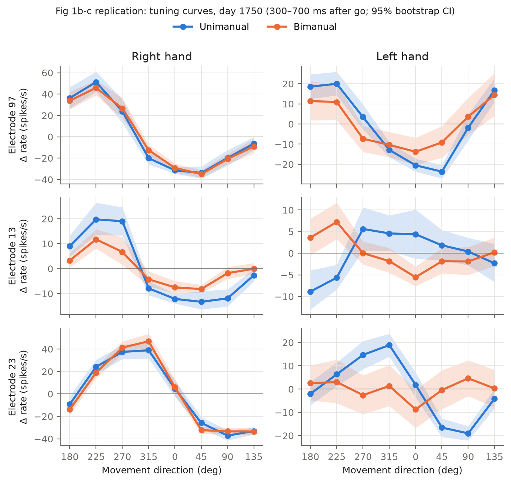</td>
</tr>
</table>

| Electrode | Paper | Ours |
|---|---|---|
| 97 | RH tuning identical uni vs bi; LH kept but slightly weaker | Same: RH overlapping, LH kept and weaker |
| 13 | Both hands weaker in the bimanual context | Same; the RH peak drops from about 20 to about 11 spikes/s |
| 23 | RH kept; LH tuning abolished | Same |

**Notes.**
- The paper plots unimanual in red and bimanual in cyan, and ours uses blue / orange.
- Our rows are electrodes and our columns are hands, the transpose of the paper's layout.
- The paper's direction axis starts at 0° (→), ours at 180°. The curves are the same up to that shift.
- Our port reproduces the authors' `tuningAnalysis.m` to 3e-14 (register #4).

## Fig 2b–c: suppression and decorrelation of tuning

<table>
<tr><th width="50%">Paper</th><th width="50%">Replication</th></tr>
<tr>
<td></td>
<td></td>
</tr>
</table>

| Quantity | Paper | Ours (95% CI) |
|---|---|---|
| Tuning-strength ratio BiR:UniR | 0.88 | 0.81 [0.78, 0.84] |
| Tuning-strength ratio BiL:UniL | 0.66 | 0.59 [0.51, 0.66] |
| RH vs LH ratio, t-test | p = 3.5 × 10⁻⁷ | p = 6 × 10⁻⁶ (n = 22 sets) |
| Correlation x: UniR-BiR / UniL-BiL / UniR-UniL / BiR-BiL | 0.87 / 0.42 / −0.30 / 0.24 | 0.86 / 0.49 / −0.34 / 0.20 |
| Correlation y: UniR-BiR / UniL-BiL / UniR-UniL / BiR-BiL | 0.84 / 0.45 / 0.46 / −0.05 | 0.86 / 0.60 / 0.51 / −0.03 |

**Notes.**
- Every bar has the right sign and ordering, and 6 of 8 correlations are within 0.05.
- The two gaps:
  - suppression about 6–7 points larger for both hands;
  - LH y-correlation 0.60 vs 0.45.
- We use split-half cvOLS. The paper's literal 5-fold is unstable at about 25 bimanual trials per set (register #23); the k-fold version is in `results/figures/fig2bc_tuning_change_kfold.png`.
- Our extra right-hand panel shows the result holds for other block groupings (#10).

## Fig 2d: laterality coding (PCA and dPCA)

<table>
<tr><th width="50%">Paper</th><th width="50%">Replication</th></tr>
<tr>
<td>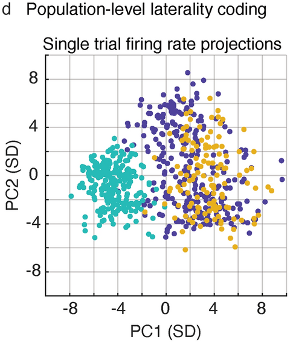</td>
<td>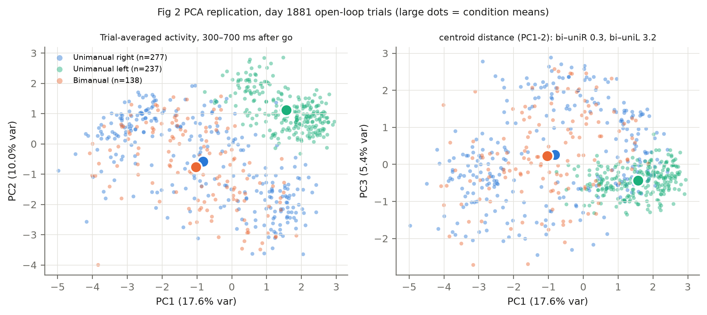</td>
</tr>
<tr>
<td>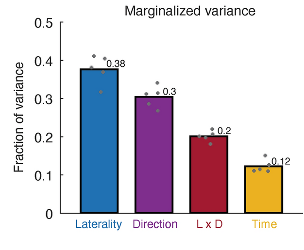</td>
<td>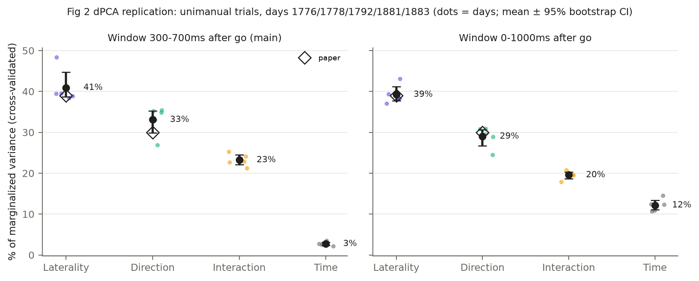</td>
</tr>
</table>

| Quantity | Paper | Ours |
|---|---|---|
| PCA: bimanual trials overlap… | UniR (UniL separate along PC1) | UniR: centroid distance in PC1–2 is 0.28 to UniR vs 3.21 to UniL |
| dPCA laterality / direction / L×D / time | 0.38 / 0.30 / 0.20 / 0.12 (figure; the text says 39% / 30%) | 0–1000 ms: **0.39 / 0.29 / 0.20 / 0.12**; 300–700 ms: 0.41 / 0.33 / 0.23 / 0.03 |

**Notes.**
- **NEW:** with the 0–1000 ms window, all four variance shares match the paper's figure within 0.01, including the interaction and time terms we hadn't compared before. That strongly suggests the paper used a window of about 1 s (#24).
- Our PCA mirrors the paper's: PC signs are arbitrary, so UniL sits on the right in ours and on the left in the paper.
- The paper scales to SD units; we use z-scored rates.

## Fig 3a–c: single-bin decoding of real data (day 1883)

<table>
<tr><th width="50%">Paper</th><th width="50%">Replication</th></tr>
<tr>
<td></td>
<td>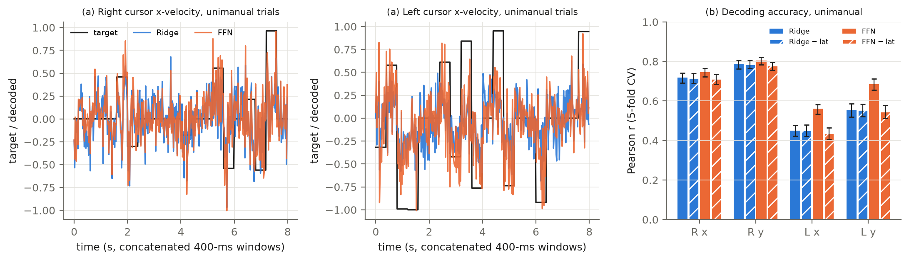</td>
</tr>
<tr>
<td>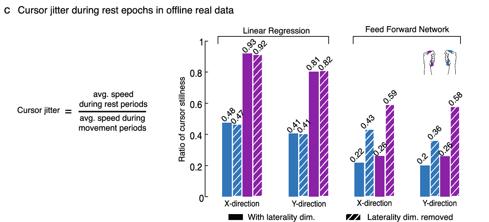</td>
<td>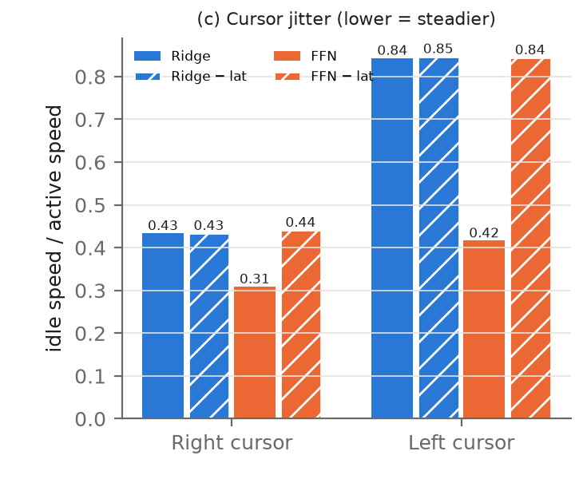</td>
</tr>
</table>

**Fig 3b, decoding r** (paper values printed on the bars; ours from 5-fold CV):

| Decoder | R x | R y | L x | L y |
|---|---|---|---|---|
| Ridge, paper / ours | 0.69 / 0.72 | 0.77 / 0.79 | 0.45 / 0.45 | 0.55 / 0.56 |
| Ridge − laterality, paper / ours | 0.69 / 0.71 | 0.77 / 0.78 | 0.45 / 0.45 | 0.55 / 0.55 |
| FFN, paper / ours | 0.77 / 0.75 | 0.82 / 0.80 | 0.59 / 0.56 | 0.70 / 0.69 |
| FFN − laterality, paper / ours | 0.71 / 0.71 | 0.78 / 0.78 | 0.53 / 0.43 | 0.62 / 0.54 |

**Fig 3c, cursor jitter** (idle speed / active speed). The paper reports x and y separately; ours pools x and y per cursor.

| Decoder | Right, paper (x / y) | Right, ours | Left, paper (x / y) | Left, ours |
|---|---|---|---|---|
| Ridge | 0.48 / 0.41 | 0.43 | 0.93 / 0.81 | 0.84 |
| Ridge − laterality | 0.47 / 0.41 | 0.43 | 0.92 / 0.82 | 0.85 |
| FFN | 0.22 / 0.20 | 0.31 | 0.26 / 0.26 | 0.42 |
| FFN − laterality | 0.43 / 0.36 | 0.44 | 0.59 / 0.58 | 0.84 |

**Notes.**
- **NEW:** 14 of the 16 decoding bars are within 0.03 of the paper's. The exceptions are FFN − laterality for the left hand, where our drop is larger (−0.13 / −0.15 vs −0.06 / −0.08).
- Jitter has the same ordering: the FFN is steadiest, and removing laterality makes it as jittery as ridge. Our FFN jitter is higher than the paper's, especially for the left hand.
- Both differences point the same way: in our FFN, more of the left-hand benefit comes from the laterality signal.
- The paper's traces (panel a) use cursor velocity; ours use the unit-direction target (#11). The cursor-velocity version is `fig3_decoding_cursor.png`.

## Fig 3d–e: simulations

<table>
<tr><th width="50%">Paper</th><th width="50%">Replication</th></tr>
<tr>
<td>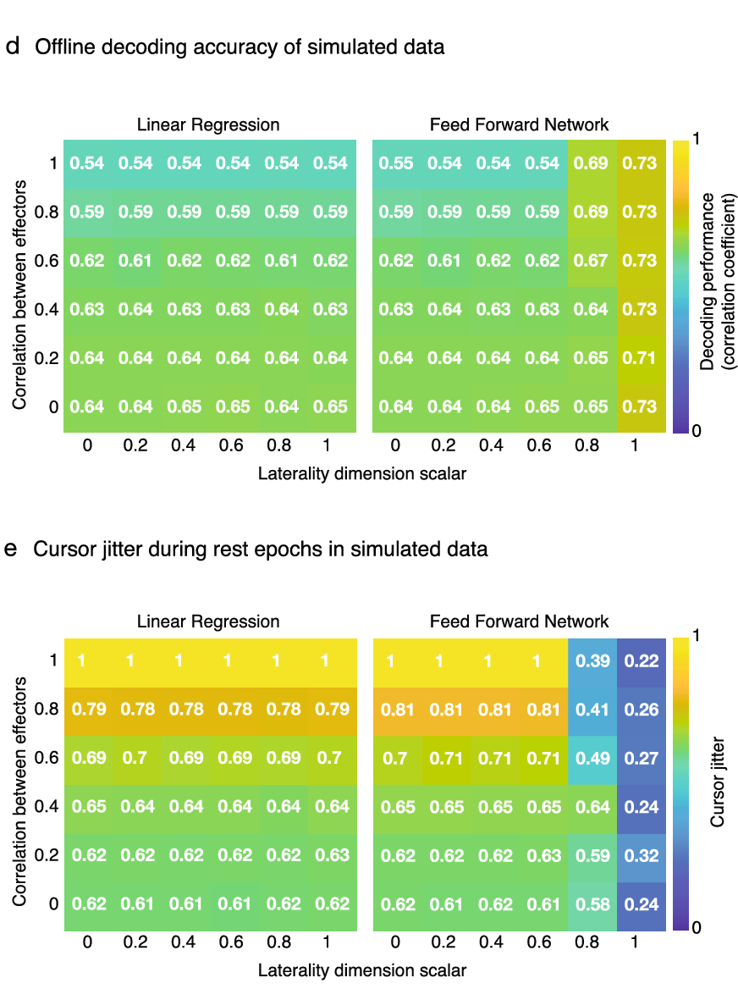</td>
<td>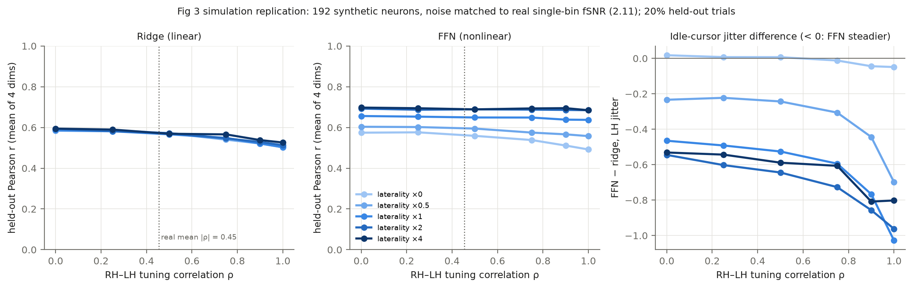</td>
</tr>
</table>

| Pattern | Paper | Ours |
|---|---|---|
| Ridge r vs RH-LH tuning correlation ρ | 0.64 (ρ = 0) → 0.54 (ρ = 1), flat across laterality | 0.59 → 0.50, flat across laterality |
| FFN r | Like ridge until the laterality scalar reaches 0.8–1, then 0.69–0.73 at every ρ | Rises with laterality; about 0.69 at every ρ for laterality ≥ 2× real |
| Jitter | Ridge 0.62 → 1 as ρ → 1; FFN 0.22–0.39 at high laterality | FFN − ridge jitter difference grows more negative with laterality and with ρ |

**Notes.**
- The axes are parameterized differently. The paper's laterality "scalar" runs from 0 to 1; ours is a multiple of the real data's laterality size (#27). We plot lines rather than heat maps, and the jitter *difference* rather than raw jitter.
- The mechanism reproduces: a linear decoder can't use laterality, while a nonlinear one can and becomes robust to correlated tuning.

## Fig 4b, d: RNN training targets and offline decoding (day 1869)

<table>
<tr><th width="50%">Paper</th><th width="50%">Replication</th></tr>
<tr>
<td>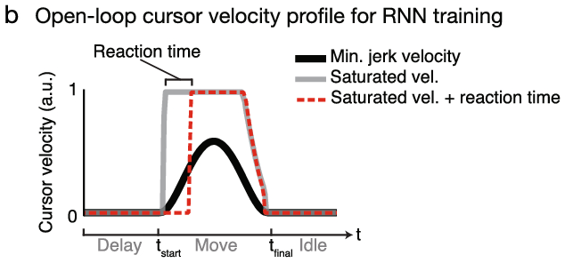 </td>
<td>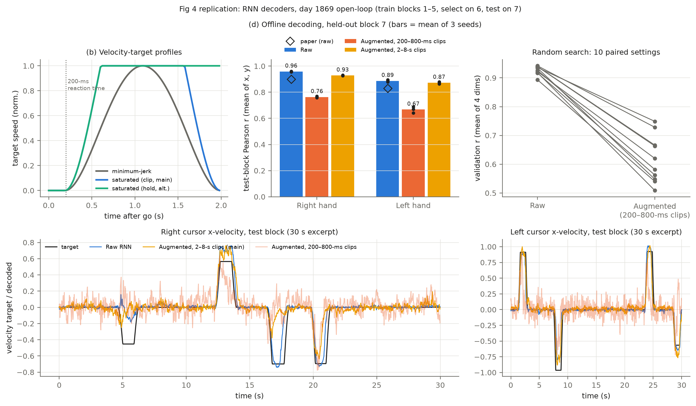</td>
</tr>
</table>

| Quantity | Paper | Ours (3 seeds) |
|---|---|---|
| Raw-trained RNN, r RH / LH | 0.90 / 0.83 | 0.96 / 0.89 |
| Augmented ("altered") RNN, r RH / LH | **0.82 / 0.82** | 2–8-s clips: 0.93 / 0.87; 200–800-ms clips: 0.76 / 0.67 |
| Change, augmented − raw | −0.08 / −0.01 | 2–8 s: −0.03 / −0.02; 200–800 ms: −0.20 / −0.22 |

**Notes.**
- **NEW:** the paper's augmented values are printed on Fig 4d. We had only the text's "slightly poorer" before.
  - The paper's drop (−0.08 RH, −0.01 LH) lies between our two clip-length readings (#14), closer to the 2–8-s reading for the LH and between the two for the RH.
  - That fits a clip length near our 2–8-s reading, or a mixed regime. It does not support 200–800 ms, whose drop is 2–20× larger than the paper's.
- Our raw r is 0.06 higher than the paper's. The setups differ: one day and a block split, vs the paper's pooled multi-day training (#28).
- **Fig 4b:** the paper's "saturated velocity" profile rises at t_start, holds and falls at t_final, matching our main "clip" reading (#13).

## Fig 4e: online raw vs augmented RNN

<table>
<tr><th width="50%">Paper</th><th width="50%">Replication</th></tr>
<tr>
<td>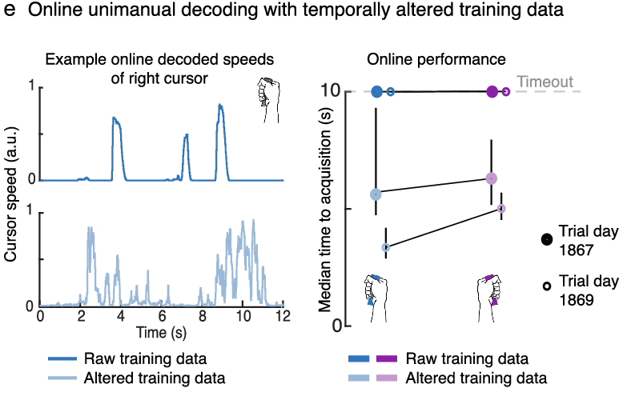</td>
<td>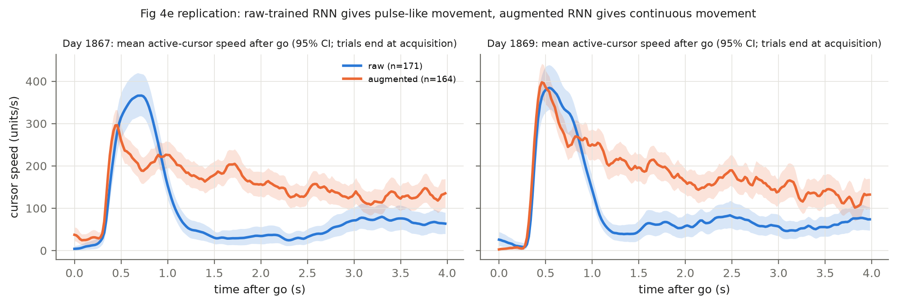 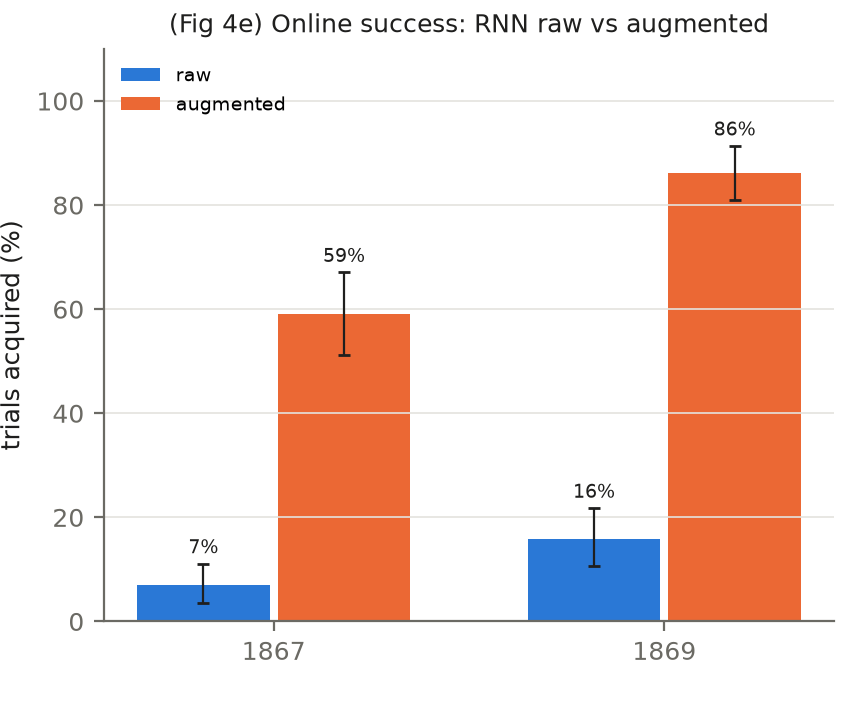</td>
</tr>
</table>

| Quantity | Paper | Ours (re-scored logs) |
|---|---|---|
| Raw RNN, decoded speed | Isolated pulses, then near zero | Mean speed: one pulse at about 0.5 s, then nearly stops |
| Augmented RNN, decoded speed | Sustained, noisier movement | Sustained speed throughout the trial |
| Median TTA, raw (days 1867 / 1869) | ≈ 10 s (timeout) for both hands on both days | Success only 7% / 16% (most trials time out) |
| Median TTA, augmented | ≈ 3–6.5 s | Success 59% / 86% |

**Notes.** We report success rate and mean speed rather than per-hand median TTA. Both show the paper's point: the raw-trained RNN mostly times out online, while the augmented one acquires targets.

## Fig 5a: online two-cursor control

<table>
<tr><th width="50%">Paper</th><th width="50%">Replication</th></tr>
<tr>
<td>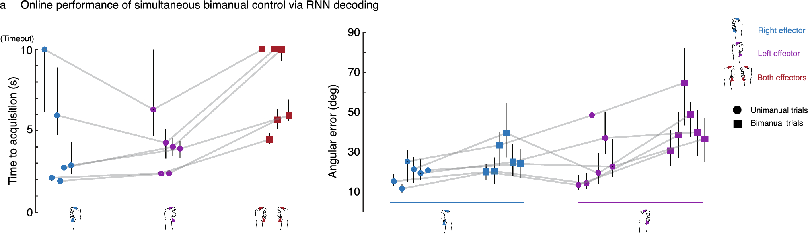</td>
<td>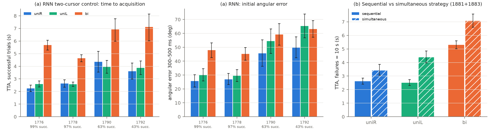</td>
</tr>
</table>

| Quantity | Paper (6 sessions, read from the figure) | Ours (4 sessions: 1776, 1778, 1790, 1792) |
|---|---|---|
| TTA, uniR | ≈ 1.9–2.9 s on 4 sessions; 5.9 and 10 on 2 | 2.2–4.4 s |
| TTA, uniL | ≈ 2.3–4.2 s; 6.3 on 1 | 2.6–4.0 s |
| TTA, bimanual | ≈ 4.4–5.9 s on 3 sessions; 10 (timeout) on 3 | 4.6–7.1 s |
| Angular error, uniR / biR | ≈ 11–25° / 20–40° | uniR 26–50°; bi (both hands pooled) 45–63° |
| Angular error, uniL / biL | ≈ 13–49° / 30–65° | uniL 30–65° |

**Notes.**
- **NEW, register #30:** on its good sessions the paper's own Fig 5a shows bimanual TTA (≈ 4.4–5.9 s) at about 2× unimanual (≈ 2–3 s), and three sessions time out entirely. Our logged result (bimanual about 2× unimanual) therefore *agrees with the figure*. It is the text's "only slightly longer" that understates the gap.
- **⚠️ Our angular errors are about 10–25° higher** than the paper's. The likely cause is the definition: which samples, cursor displacement vs decoded velocity, and the reference direction (#8). This remains open.
- The paper has 6 sessions, ours 4. The Dryad data for 1752 and 1771 has no closed-loop blocks (#29).

## Fig 5b: sequential vs simultaneous

<table>
<tr><th width="50%">Paper</th><th width="50%">Replication</th></tr>
<tr>
<td>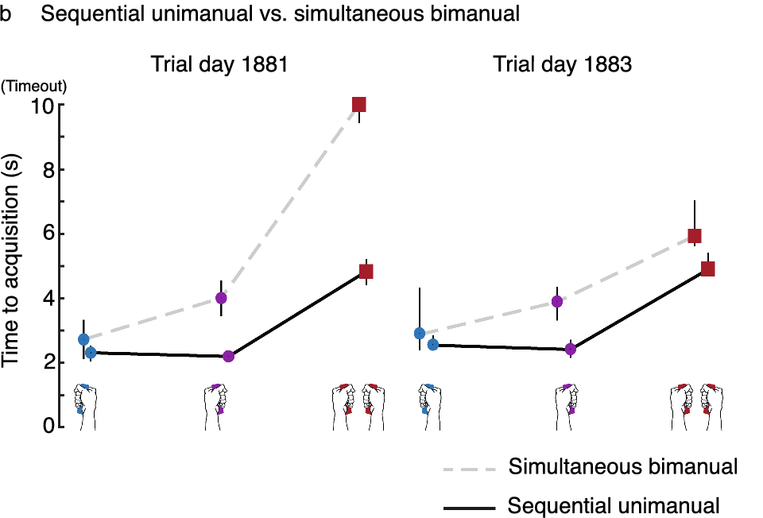</td>
<td>Right-hand panel of the replication image under Fig 5a above (pooled over 1881 + 1883).</td>
</tr>
</table>

| TTA (s), uniR / uniL / bi | Paper 1881 | Paper 1883 | Paper mean | Ours (pooled) |
|---|---|---|---|---|
| Sequential | ≈ 2.3 / 2.2 / 4.8 | ≈ 2.5 / 2.4 / 4.9 | 2.4 / 2.3 / 4.9 | 2.6 / 2.5 / 5.3 |
| Simultaneous | ≈ 2.7 / 4.0 / 10 | ≈ 2.9 / 3.9 / 5.9 | 2.8 / 4.0 / 8.0 | 3.4 / 4.4 / 7.1 |

**Notes.** Sequential is faster for every condition, in both. Values agree within about 0.6 s, except simultaneous bimanual: the paper's 1881 point is a 10-s timeout median, and ours pools both days with failures counted as 10 s.

## Fig 5c: linear vs RNN

<table>
<tr><th width="50%">Paper</th><th width="50%">Replication</th></tr>
<tr>
<td>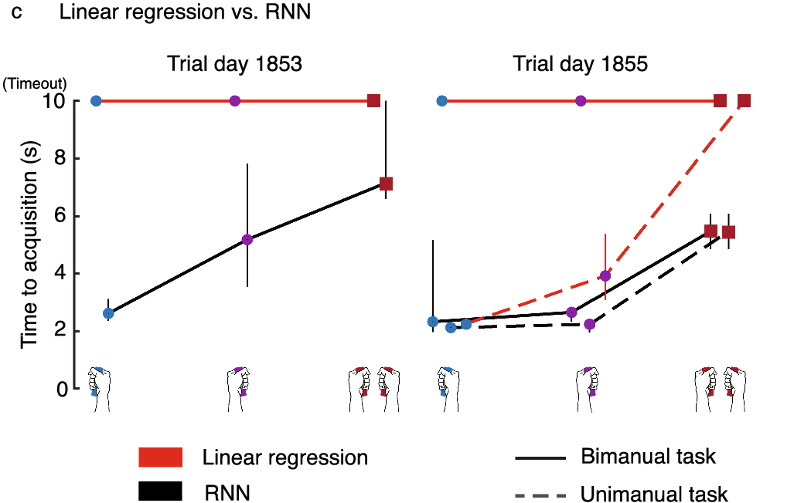</td>
<td>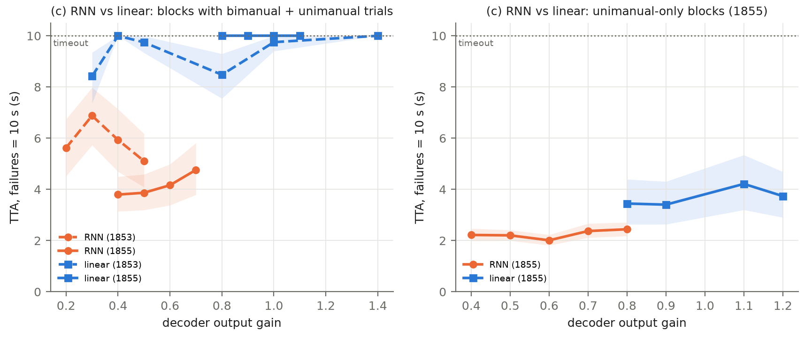</td>
</tr>
</table>

| Condition | Paper | Ours |
|---|---|---|
| Linear decoder, blocks with bimanual trials (1853, 1855) | Every condition times out (10 s) | Mostly time out at every gain (0–47% success) |
| RNN, same blocks | ≈ 2.3–2.6 s uni, 5.6–7.1 s bi | TTA about 3.8–7 s across gains |
| Linear, unimanual-only blocks (1855) | ≈ 2.2 s uniR, 3.9 s uniL, bi times out | TTA about 3.4–4.2 s across gains |
| RNN, unimanual-only blocks (1855) | ≈ 2.1–2.2 s uni, 5.5 s bi | TTA about 2.0–2.4 s across gains |

**Notes.** The paper shows one point per condition; we plot TTA against the decoder output gain, because the logs contain gain sweeps. The conclusion is the same: the linear decoder works when only one hand is in play but fails once both hands are involved, while the RNN works in both.

## Supp Fig 1: single-electrode tuning

<table>
<tr><th width="50%">Paper</th><th width="50%">Replication</th></tr>
<tr>
<td>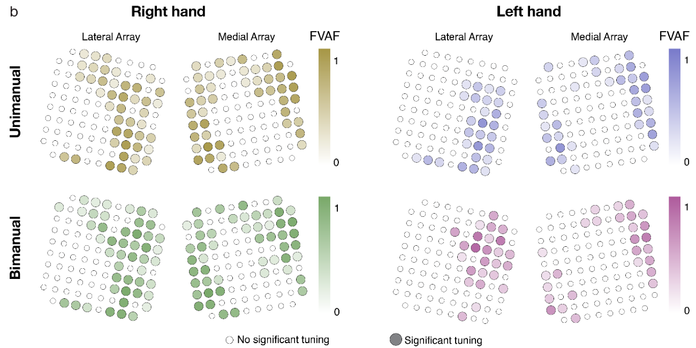 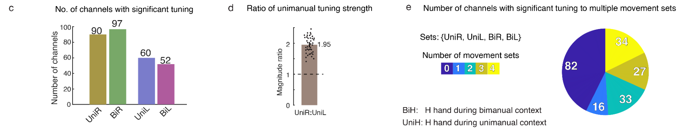</td>
<td>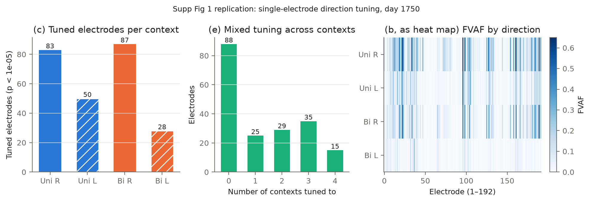</td>
</tr>
</table>

| Quantity | Paper | Ours |
|---|---|---|
| (c) Tuned electrodes, uniR / biR / uniL / biL (ours: day 1750) | 90 / 97 / 60 / 52 | 83 / 87 / 50 / **28** |
| (d) Unimanual tuning ratio, R:L | 1.95 | 1.70 (day 1776) |
| (e) Electrodes tuned to 0 / 1 / 2 / 3 / 4 contexts | 82 / 16 / 33 / 27 / 34 | 88 / 25 / 29 / 35 / **15** |

**Notes.**
- **NEW:** these counts were "figure only" before.
  - The right-hand preference reproduces: uniR > uniL and biR > biL in both.
  - But we find fewer tuned electrodes, most clearly for the left hand in the bimanual context (28 vs 52). Hence fewer electrodes tuned to all 4 contexts (15 vs 34).
- **Possible causes:** the significance threshold (we use p < 1e-5; the caption gives none), the analysis window (#18), the quadrant definition (#6), or a different session. These are on the paper-check list.
- **Supp Fig 1b** draws the arrays as *lateral* and *medial*. The data doesn't say which channels belong to which (#36), so we show an electrode × context heat map instead (#19).

## Supp Fig 2: velocity distributions and bimanual decoding

<table>
<tr><th width="50%">Paper</th><th width="50%">Replication</th></tr>
<tr>
<td>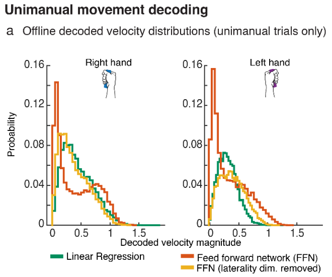 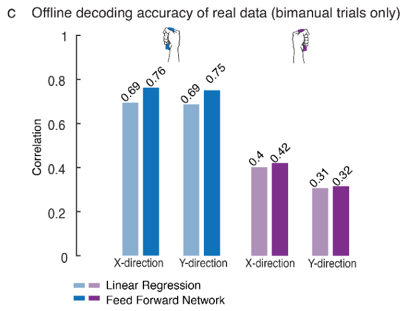</td>
<td>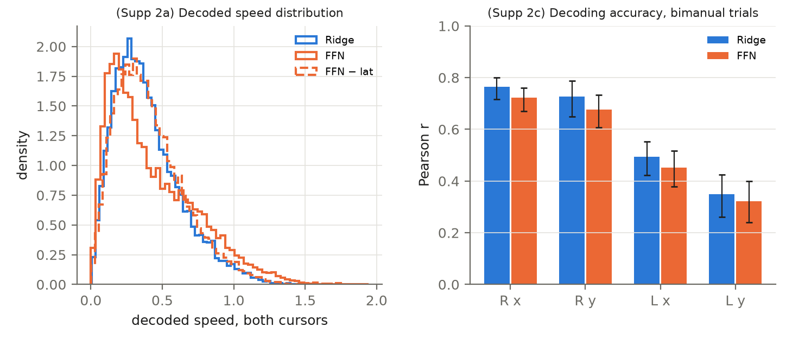</td>
</tr>
</table>

| Bimanual-trial decoding r | R x | R y | L x | L y |
|---|---|---|---|---|
| Ridge, paper / ours | 0.69 / 0.76 | 0.69 / 0.72 | 0.40 / 0.49 | 0.31 / 0.35 |
| FFN, paper / ours | 0.76 / 0.72 | 0.75 / 0.68 | 0.42 / 0.45 | 0.31 / 0.32 |

**Notes.**
- **NEW:** values from the paper's bar labels.
  - The main claim holds: RH decodes far better than LH on bimanual trials.
  - However, the paper's FFN is slightly *better* than ridge here, while ours is slightly *worse*. Bimanual trials are few, so the FFN may be data-limited in our cross-validation (#25).
- **Supp 2a:** the paper plots per-hand probability histograms, and we pool both cursors. Both show the FFN decoding more near-zero speeds, and the FFN without laterality shifting toward ridge.

## Supp Fig 4: fSNR, real vs simulated

<table>
<tr><th width="50%">Paper</th><th width="50%">Replication</th></tr>
<tr>
<td>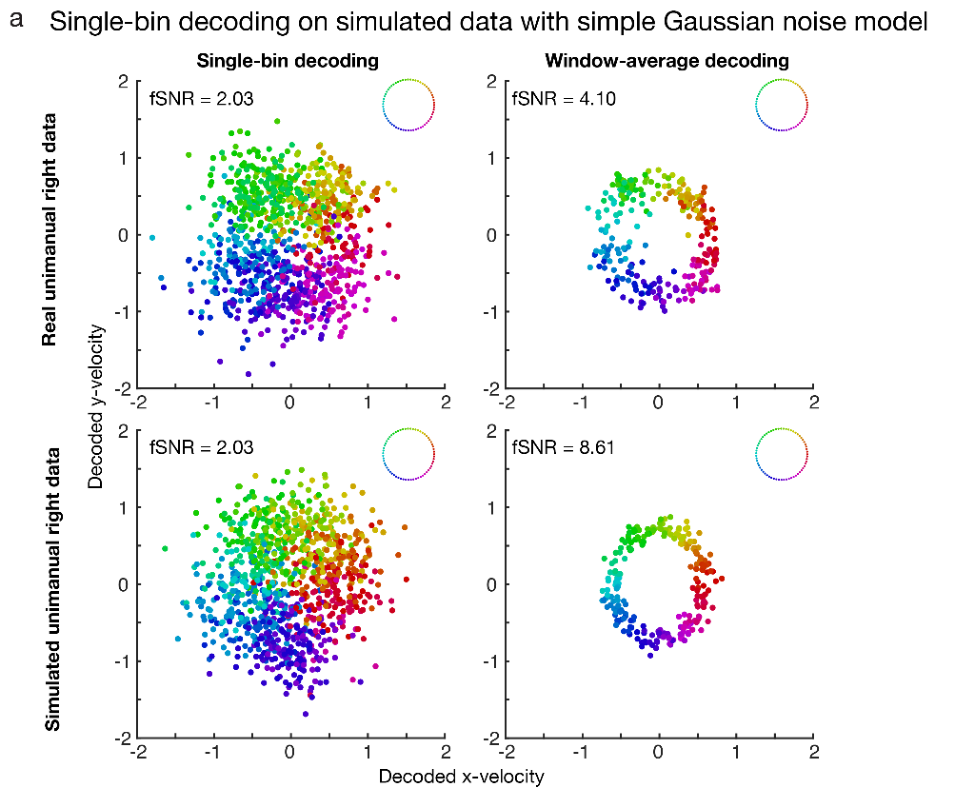</td>
<td>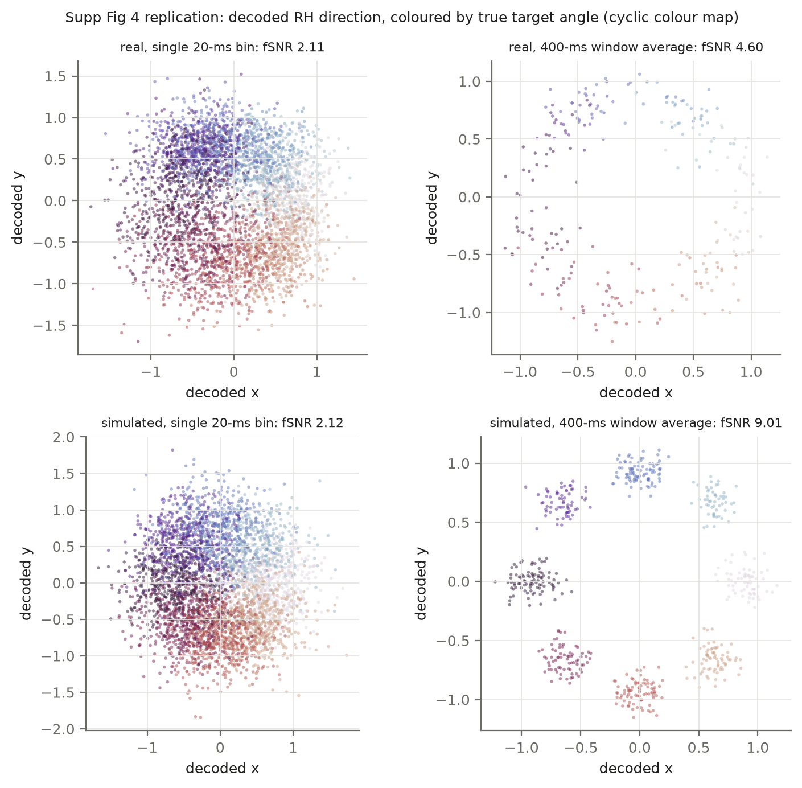</td>
</tr>
</table>

| fSNR | Paper | Ours |
|---|---|---|
| Real, single 20-ms bin | 2.03 | 2.11 |
| Real, 400-ms window average | 4.10 | 4.60 |
| Simulated i.i.d. noise, single bin (matched) | 2.03 | 2.12 |
| Simulated i.i.d. noise, window average | 8.61 | 9.01 |

**Notes.** The paper's point reproduces with close values: noise matched on single bins overstates window-average fSNR about 2×, because real noise is correlated over time.

---

## What this comparison changed
- **Fig 5a TTA (#30):** the paper's own figure shows bimanual TTA about 2× unimanual, as our logs do. Only the text's "only slightly longer" disagrees.
- **Fig 4d / clip length (#14):** the paper's augmented offline r (0.82 / 0.82) is now known, and it rules out the 200–800-ms reading as the paper's offline model.
- **Fig 2 dPCA (#24):** all four variance shares match the 0–1000 ms window.
- **Supp Fig 1 counts:** a real gap, with fewer tuned electrodes in ours, mostly bimanual LH.
- **Supp Fig 2c:** on bimanual trials the FFN ≥ ridge in the paper but not in ours; small differences.
- **Fig 5a angular error (#8):** ours is about 10–25° higher, which points to a definition difference.
