# Figure by figure: the paper vs our replication

*2026-11-23. Each published figure (left) is shown next to our results redrawn in the paper's layout (right), in the paper's order: Figs 1–5, then the supplementary figures. Every major difference is listed with the evidence for its cause.*

## Sources and how to read this
- **Paper figures:** Deo, Willett, Avansino, Hochberg, Henderson & Shenoy, "Brain control of bimanual movement enabled by recurrent neural networks", *Sci Rep* 14:1598 (2024), [doi:10.1038/s41598-024-51617-3](https://doi.org/10.1038/s41598-024-51617-3). Published under [CC BY 4.0](https://creativecommons.org/licenses/by/4.0/). The panels are cropped from the article and its Supplementary Information, with no other changes.
- **Our figures (right column):** made by [`scripts/paper_style_figures.py`](../scripts/paper_style_figures.py) from our saved results. They copy the paper's panel arrangement, chart types, colour roles and, where the paper states it, the statistic: for example median time to acquisition with failures counted as 10 s. The numbers drawn are in `results/paperstyle/values.json`. Our original-format figures are linked under each section.
- **Diagnostics:** each cause given below was tested by changing one analysis choice at a time ([`scripts/diagnose_differences.py`](../scripts/diagnose_differences.py), output `results/paperstyle/diagnostics.json`).
- **Paper values:** values printed on the paper's figures are quoted exactly. Values read off plotted points are marked ≈ (about ±0.02, or ±0.3 s / ±3°).
- **Online figures (4e, 5):** the experiments can't be re-run. Our panels re-score the logged closed-loop trials.

## Summary

| Figure | Match in the paper's format |
|---|---|
| [Fig 1c](#fig-1c-single-electrode-tuning-curves) | ✅ Curve shapes and uni-vs-bi changes match electrode by electrode |
| [Fig 2b–c](#fig-2bc-suppression-and-decorrelation) | ✅ Same pattern; ⚠️ our suppression is about 7 points larger (partly explained) |
| [Fig 2d](#fig-2d-laterality-coding) | ✅ PC1 time course and all 4 dPCA shares match (0.39 / 0.29 / 0.20 / 0.12 vs 0.38 / 0.30 / 0.20 / 0.12) |
| [Fig 3a–c](#fig-3ac-decoding-real-data) | ✅ Ridge r and ridge jitter match to about 0.03; ⚠️ our FFN is jitterier and leans more on laterality (open) |
| [Fig 3d–e](#fig-3de-simulations) | ✅ Same trends; the axes are parameterized differently |
| [Fig 4d](#fig-4d-rnn-offline-decoding) | ✅ Raw > altered; our raw r is 0.06 higher; the paper's altered r lies between our two clip readings |
| [Fig 4e](#fig-4e-online-raw-vs-altered-rnn) | ✅ Raw RNN times out, altered RNN acquires targets; one point differs (1867 LH) |
| [Fig 5a](#fig-5-online-two-cursor-control) | ✅ **All 18 time-to-acquisition points match** once the paper's statistic and session set are used; angular errors match with the paper-consistent definition |
| [Fig 5b](#fig-5-online-two-cursor-control) | ✅ Within about 0.3 s on both days |
| [Fig 5c](#fig-5-online-two-cursor-control) | ✅ Within about 0.6 s; linear decoder times out exactly where the paper's does |
| [Supp Fig 1](#supp-fig-1-single-electrode-tuning) | ✅ 1d ratio 1.92 vs 1.95; ⚠️ c/e counts lower at our threshold (explained by threshold and power sensitivity) |
| [Supp Fig 2](#supp-fig-2-speed-distributions-and-bimanual-decoding) | ✅ RH ≫ LH on bimanual trials; ⚠️ our FFN lacks the paper's spike of near-zero speeds (same open FFN issue) |
| Supp Fig 3 | — Architecture diagram, no data ([methods_notes.md](methods_notes.md)) |
| [Supp Fig 4](#supp-fig-4-fsnr) | ✅ fSNR 2.11 vs 2.03; simulated points cluster because we simulated 8 directions |

**Not redrawn:** illustrations or raw-data views, namely Fig 1a (setup), 1b (spike rasters; the data is binned), 2a (schematic), 4a–c (diagrams), Supp Fig 1a (MRI) and 1b (array layout; electrode positions aren't in the data, #19), and Supp Fig 4b–c.

## Major differences and their causes

| # | Difference | Cause | Evidence | Status |
|---|---|---|---|---|
| 1 | Fig 5a: bimanual TTA about 2× unimanual in our earlier summary, vs "only slightly longer" in the text | **The statistic.** The paper plots the *median* TTA with failures counted as 10 s; our earlier summary used the *mean over successful trials* ([fig5_behavior.py:98](../scripts/fig5_behavior.py#L98)). | With the median and failures counted as 10 s, all 18 of our points match the paper's Fig 5a (table under Fig 5). The figure itself shows bimanual at about 2× unimanual on its good sessions. | **Explained.** Our data agree with the paper's figure; the text's wording understates the gap (#30). |
| 2 | Fig 5a: the paper has 6 sessions, we had 4 | **Session set.** The paper's 6 sessions are the 4 evaluation days plus the *simultaneous-strategy* blocks of days 1881 and 1883. | Those two sessions reproduce the paper's two remaining sessions (uniR / uniL / bi 2.6 / 4.0 / 10 s and 2.8 / 3.9 / 5.9 s vs ≈ 2.7 / 4.0 / 10 and 2.9 / 3.9 / 5.9). Supp Table 2 also lists 1881/1883 under Fig 5A. | **Explained;** resolves register #29 |
| 3 | Fig 5a angular error about 10–25° higher in ours | **Definition.** Ours is the mean over 20-ms bins of each bin's movement angle ([behavior.py:115](../bimanual/behavior.py#L115)), averaged over trials. Single-bin steps are noisy, which inflates the error. The paper's values match the angle of the *net* displacement over 300–500 ms, summarised by the median over trials. | Net displacement and median (D2), across the 6 sessions: uniR 11–23°, biR 20–40°, uniL 12–39°, biL 32–63°, vs the paper's ≈ 11–25°, 20–40°, 13–49°, 30–65°. Our per-bin mean: 26–50°, 36–63°, 30–65°, 54–77°. | **Explained** (#8) |
| 4 | Supp Fig 1d: R:L tuning ratio 1.70 vs 1.95 | **Aggregation.** 1.70 came from one pooled fit on day 1776 ([fig2_tuning_change.py:145](../scripts/fig2_tuning_change.py#L145)). The paper plots one dot per block set and their mean. | Mean over our 22 block sets: **1.92** (median 1.93). | **Explained** |
| 5 | Supp Fig 1c/e: fewer significantly tuned electrodes (biL 28 vs 52) | **Statistical power and threshold.** At p < 1e-5 ([fig1_supp_anova.py:53](../scripts/fig1_supp_anova.py#L53)) the counts depend strongly on trial numbers and grouping. | At p < 1e-3 with the 8 target directions of Fig 1: 90 / 100 / 62 / 40 tuned, and 82 electrodes tuned to no context, vs the paper's 90 / 97 / 60 / 52 and 82 (D1). No single variant matches all counts. biL is the most sensitive (28–82 across variants). | **Partly explained:** the gap sits within the range of plausible analysis choices; the paper's exact threshold or trial set is unknown |
| 6 | Fig 2c: UniL-BiL correlation 0.49 / 0.60 vs 0.42 / 0.45 | **Estimator and regressors.** We use split-half cvOLS (#23) and unit direction at the go cue (#21). The paper uses 5-fold cvOLS with Eq. 2's per-time-step target − cursor regressors. | With the paper's literal method: **0.41 / 0.44**; the other 6 correlations stay within 0.11 of the paper's (D4). | **Explained** |
| 7 | Fig 2b: suppression larger in ours (ratio 0.81 / 0.59 vs 0.88 / 0.66) | **Estimator choice, partly.** | Across 4 estimator × regressor variants (D4): RH 0.81–0.89, LH 0.38–0.61. The paper's literal method gives 0.82 / 0.52. Only 5-fold with unit directions reaches the paper's RH value (0.89), but its LH is unstable (SD 1.25). | **Partly open:** the LH-suppressed-more conclusion holds in every variant, but no variant reproduces both ratios |
| 8 | Fig 3 / Supp Fig 2: our FFN is jitterier at rest (0.33–0.45 vs 0.20–0.26), loses more without laterality (LH −0.13 vs −0.07), sits below ridge on bimanual trials, and lacks the paper's spike of near-zero decoded speeds | **Something in the FFN itself** (architecture or implementation details the paper doesn't give: TensorFlow 1, "1 dense layer, 512 units"). Not the data or the metric. | Ridge jitter matches the paper almost exactly (0.47 / 0.40 / 0.92 / 0.78 vs 0.48 / 0.41 / 0.93 / 0.81), so data and metric agree. FFN weight decay, early stopping and training length change nothing (D3): our trainer always restores the weights with the best validation score ([decoders.py:127](../bimanual/decoders.py#L127)). | **Open** (#25) |
| 9 | Fig 4d: raw RNN r 0.96 / 0.89 vs 0.90 / 0.83 | **Training design (likely).** Our RNN is trained on blocks 1–5 of the same day and tested on block 7 (#28). The paper's decoders were trained on data pooled over days. | A design difference, not tested. Both show the same ordering: raw > altered, and RH > LH. | Likely; not tested |
| 10 | Fig 4d: altered r 0.82 / 0.82 in the paper | **Clip length (#14).** | Lies between our 2–8-s clips (0.93 / 0.87) and our 200–800-ms clips (0.76 / 0.67). It rules out 200–800 ms as the paper's offline model. | Consistent with our 2–8-s choice |
| 11 | Fig 4e: day 1867 LH altered median 10 s (timeout) vs ≈ 6.6 s | **Unknown.** We pool every altered-RNN block of the day; the paper may show a subset. | The other 7 points agree (raw = 10 s on both days and hands; 1869 RH 3.3 vs ≈ 3.3, LH 5.0 vs ≈ 5.0). 1867 RH: 4.8 vs ≈ 6. | Minor, open |
| 12 | Supp Fig 4: our simulated window-average points form 8 clusters; the paper's form a ring | **Simulation design.** We simulated 8 target directions ([simulate.py:101](../bimanual/simulate.py#L101), #27); the paper's targets vary continuously. | fSNR values match (real 2.11 vs 2.03; simulated window-average 9.01 vs 8.61). | **Explained** (format only) |

---

## Fig 1c: single-electrode tuning curves

<table>
<tr><th width="50%">Paper</th><th width="50%">Ours, paper layout (day 1750)</th></tr>
<tr>
<td>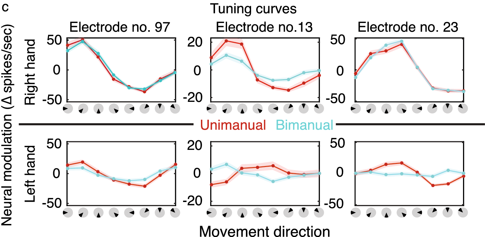</td>
<td>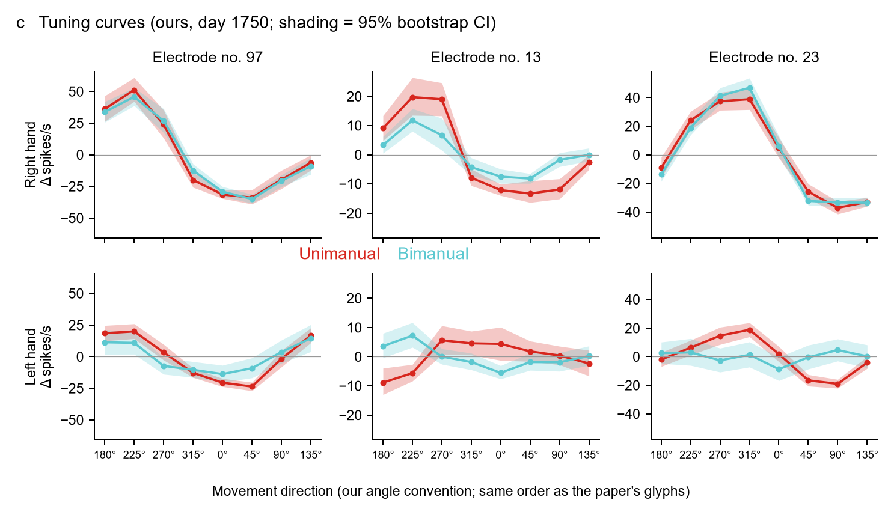</td>
</tr>
</table>

Original-format figure: [fig1_tuning_curves.png](../results/figures/fig1_tuning_curves.png).

**Notes.**
- **Direction order:** the curves line up position by position with the paper's. For example, electrode 97 peaks at position 2 and dips at position 6, and electrode 23 peaks at position 4. So the direction order is the same; only the labels differ (our angle labels vs the paper's arrow glyphs).
- **The changes per electrode match:**
  - 97: RH unchanged, LH weaker;
  - 13: both hands weaker in the bimanual context;
  - 23: RH unchanged, LH tuning abolished.
- Our port reproduces the authors' `tuningAnalysis.m` to 3e-14 (#4).

## Fig 2b–c: suppression and decorrelation

<table>
<tr><th width="50%">Paper</th><th width="50%">Ours, paper layout</th></tr>
<tr>
<td>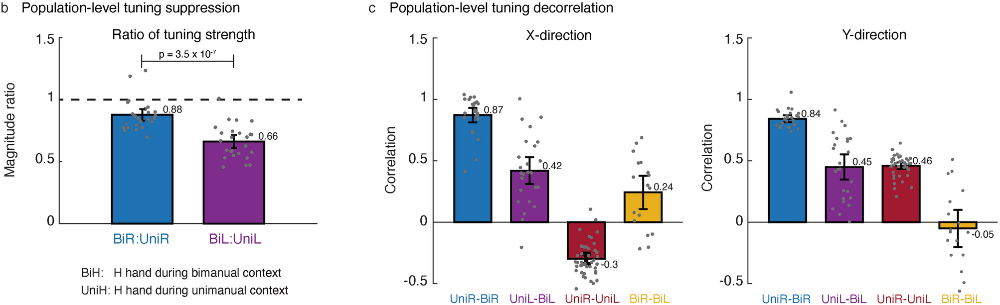</td>
<td>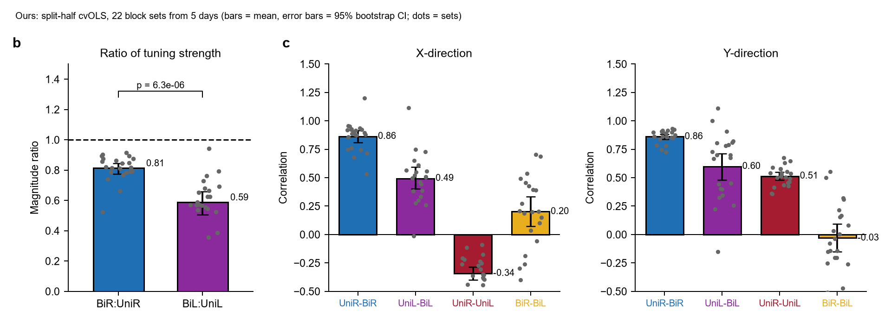</td>
</tr>
</table>

Original-format figure: [fig2bc_tuning_change_splithalf.png](../results/figures/fig2bc_tuning_change_splithalf.png).

| Quantity | Paper | Ours (split-half, unit direction) | Paper's literal method (5-fold, Eq. 2 regressors; D4) |
|---|---|---|---|
| BiR:UniR / BiL:UniL | 0.88 / 0.66 (p = 3.5e-7) | 0.81 / 0.59 (p = 6.3e-6) | 0.82 / 0.52 |
| x: UniR-BiR / UniL-BiL / UniR-UniL / BiR-BiL | 0.87 / 0.42 / −0.30 / 0.24 | 0.86 / 0.49 / −0.34 / 0.20 | 0.85 / **0.41** / −0.33 / 0.18 |
| y: UniR-BiR / UniL-BiL / UniR-UniL / BiR-BiL | 0.84 / 0.45 / 0.46 / −0.05 | 0.86 / 0.60 / 0.51 / −0.03 | 0.88 / **0.44** / 0.49 / −0.16 |

**Differences** (rows 6–7 of the table above):
- The UniL-BiL gap disappears with the paper's literal method.
- The ratios stay below the paper's in every variant.
- **Dot counts:** the paper's UniR-UniL bars have about twice as many dots as its other bars. It likely computed that statistic on more block sets, since it needs no bimanual trials. Ours uses the same 22 sets for every bar.

## Fig 2d: laterality coding

<table>
<tr><th width="50%">Paper</th><th width="50%">Ours, paper layout</th></tr>
<tr>
<td>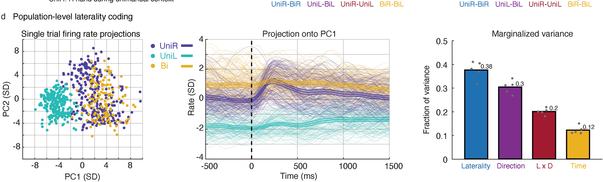</td>
<td>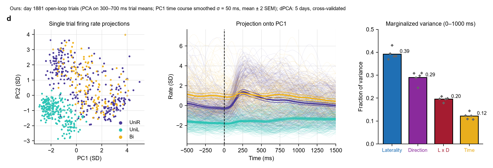</td>
</tr>
</table>

Original-format figures: [fig2_pca.png](../results/figures/fig2_pca.png), [fig2_dpca.png](../results/figures/fig2_dpca.png).

| Quantity | Paper | Ours |
|---|---|---|
| PC1 before the go cue: Bi / UniR / UniL | ≈ +1 / ≈ 0 / ≈ −1.9 | +0.99 / −0.08 / −1.71 |
| PC1 after the go cue | UniR rises to meet Bi at about 250 ms; UniL stays low | Same |
| dPCA laterality / direction / L×D / time | 0.38 / 0.30 / 0.20 / 0.12 | 0.39 / 0.29 / 0.20 / 0.12 (0–1000-ms window) |

**Notes.**
- **NEW:** the PC1 time course, not previously replicated, reproduces the paper's: laterality is already present before the movement, during the delay.
- Our 300–700-ms window gives dPCA 0.41 / 0.33 / 0.23 / 0.03. The paper's numbers match the 0–1000-ms window (#24).
- PC signs are arbitrary; we flipped them to the paper's orientation.
- Our PC axes span about half the paper's range. The paper doesn't say how it scaled to "SD" units.

## Fig 3a–c: decoding real data

<table>
<tr><th width="50%">Paper</th><th width="50%">Ours, paper layout (day 1883)</th></tr>
<tr>
<td>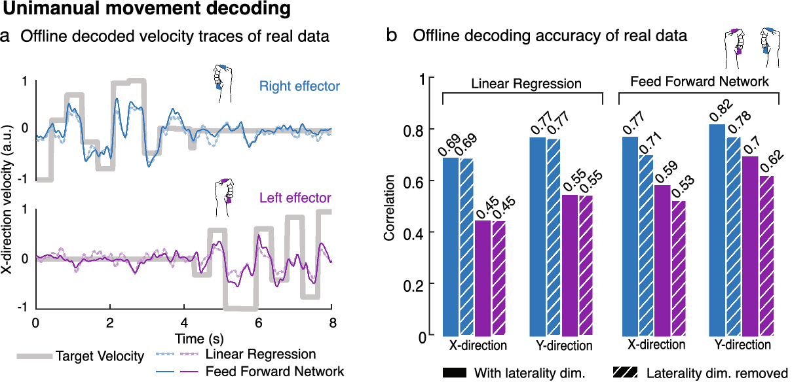<br></td>
<td>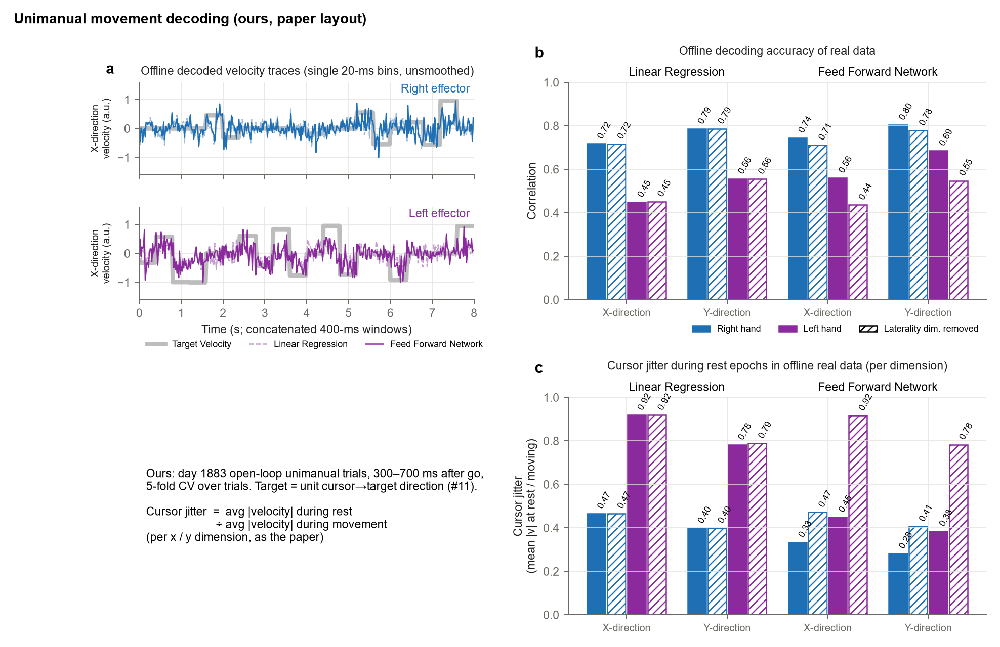</td>
</tr>
</table>

Original-format figure: [fig3_decoding_direction.png](../results/figures/fig3_decoding_direction.png).

**Decoding r** (R x / R y / L x / L y):

| Decoder | Paper | Ours |
|---|---|---|
| Ridge | 0.69 / 0.77 / 0.45 / 0.55 | 0.72 / 0.79 / 0.45 / 0.56 |
| Ridge − laterality | 0.69 / 0.77 / 0.45 / 0.55 | 0.72 / 0.79 / 0.45 / 0.56 |
| FFN | 0.77 / 0.82 / 0.59 / 0.70 | 0.74 / 0.80 / 0.56 / 0.69 |
| FFN − laterality | 0.71 / 0.78 / 0.53 / 0.62 | 0.71 / 0.78 / 0.44 / 0.55 |

**Cursor jitter**, mean |v| at rest ÷ mean |v| while moving, per dimension (the paper's definition; our original figure pooled x and y):

| Decoder | Paper | Ours |
|---|---|---|
| Ridge | 0.48 / 0.41 / 0.93 / 0.81 | 0.47 / 0.40 / 0.92 / 0.78 |
| Ridge − laterality | 0.47 / 0.41 / 0.92 / 0.82 | 0.47 / 0.40 / 0.92 / 0.79 |
| FFN | 0.22 / 0.20 / 0.26 / 0.26 | 0.33 / 0.28 / 0.45 / 0.38 |
| FFN − laterality | 0.43 / 0.36 / 0.59 / 0.58 | 0.47 / 0.41 / 0.92 / 0.78 |

**Differences** (row 8 of the table above):
- **Ridge matches the paper** within 0.03 on every bar, for both r and jitter, so the data, targets and metrics are the same.
- **Our FFN differs:**
  - it is steadier than ridge but not as steady as the paper's FFN;
  - removing laterality returns its jitter fully to ridge's level, where the paper's FFN keeps about half its advantage.
- **Ruled out (D3):** the FFN's training settings (weight decay, early stopping, epochs).
- **Traces:** the paper's look smoother than ours, which are single unsmoothed 20-ms bins. The paper may have smoothed them for display; it doesn't say.

## Fig 3d–e: simulations

<table>
<tr><th width="50%">Paper</th><th width="50%">Ours, paper layout</th></tr>
<tr>
<td></td>
<td>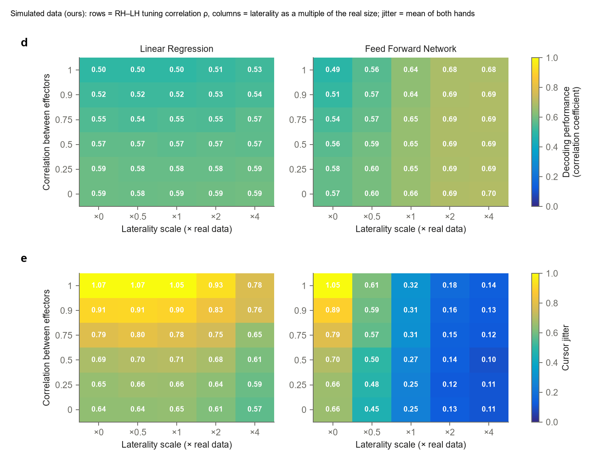</td>
</tr>
</table>

Original-format figure: [fig3_simulations.png](../results/figures/fig3_simulations.png).

| Pattern | Paper | Ours |
|---|---|---|
| Ridge r, ρ = 0 → 1 | 0.64 → 0.54, flat across laterality | 0.59 → 0.50, flat across laterality |
| FFN r | Like ridge until laterality reaches 0.8–1, then 0.69–0.73 at every ρ | Rises with laterality; 0.69–0.70 at ×2–×4 for every ρ |
| Ridge jitter, ρ = 0 → 1 | 0.62 → 1 | 0.64 → 1.07 |
| FFN jitter at high laterality | 0.22–0.39 | 0.25–0.32 at ×1; 0.10–0.14 at ×4 |

**Notes.**
- The laterality axes differ. The paper's runs from 0 to 1 on a scale it doesn't define. Ours is a multiple of the real data's laterality size, and the paper's switch-on near 0.8–1 corresponds roughly to our ×1–×2 (#27).
- The mechanism is the same: correlated tuning hurts a linear decoder, and laterality lets a nonlinear one recover.

## Fig 4d: RNN offline decoding

<table>
<tr><th width="50%">Paper</th><th width="50%">Ours, paper layout (day 1869, held-out block 7)</th></tr>
<tr>
<td>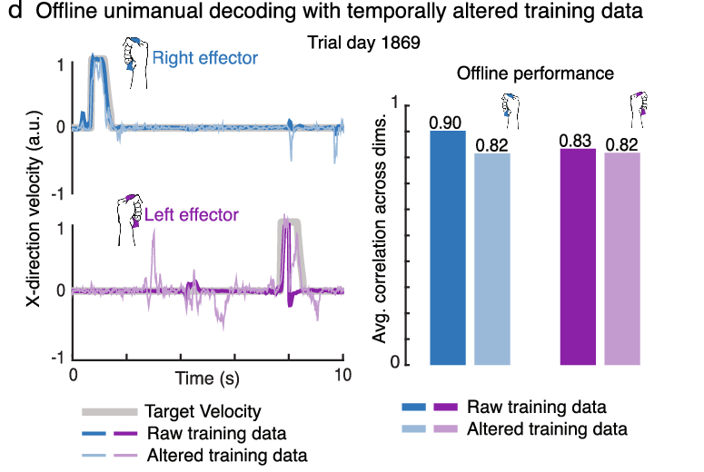</td>
<td>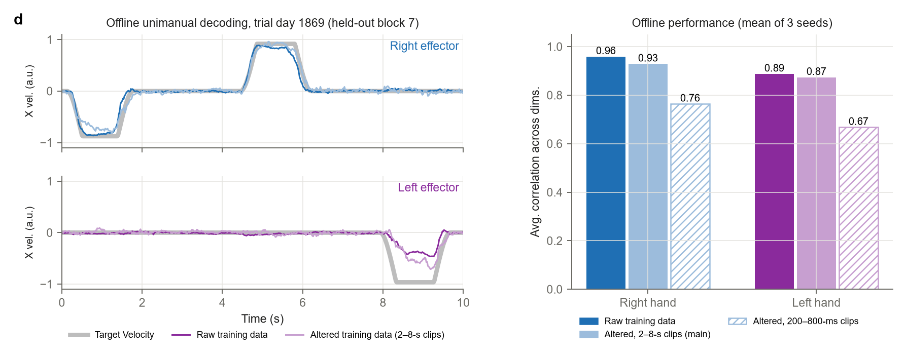</td>
</tr>
</table>

Original-format figure: [fig4_rnn.png](../results/figures/fig4_rnn.png).

| r, RH / LH | Paper | Ours (3 seeds) |
|---|---|---|
| Raw training data | 0.90 / 0.83 | 0.96 / 0.89 |
| Altered training data | 0.82 / 0.82 | 2–8-s clips (main): 0.93 / 0.87; 200–800-ms clips: 0.76 / 0.67 |

**Differences** (rows 9–10 of the table above):
- Our raw RNN scores higher, likely because it is trained on the same day (#28).
- The paper's altered decoder loses less than our 200–800-ms version and more than our 2–8-s version.

## Fig 4e: online raw vs altered RNN

<table>
<tr><th width="50%">Paper</th><th width="50%">Ours, paper layout (closed-loop logs)</th></tr>
<tr>
<td></td>
<td>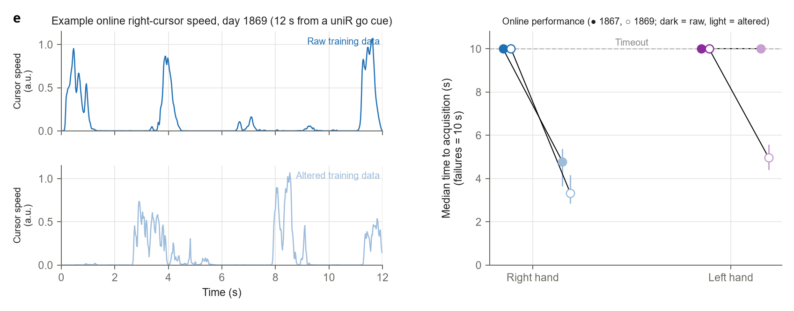</td>
</tr>
</table>

Original-format figure: [fig4e_online_speed.png](../results/figures/fig4e_online_speed.png).

| Median TTA (s), failures = 10 s | Paper ≈ | Ours |
|---|---|---|
| Raw RNN, both hands, 1867 and 1869 | 10 (timeout) | 10 (timeout) |
| Altered, RH: 1867 / 1869 | 6 / 3.3 | 4.8 / 3.3 |
| Altered, LH: 1867 / 1869 | 6.6 / 5.0 | 10 / 5.0 |

**Notes.**
- **Example speed traces:** the raw RNN gives isolated pulses and the altered RNN sustained, noisier movement, as in the paper.
- **1867 LH:** see row 11 of the table above.

## Fig 5: online two-cursor control

<table>
<tr><th width="50%">Paper</th><th width="50%">Ours, paper layout (closed-loop logs)</th></tr>
<tr>
<td>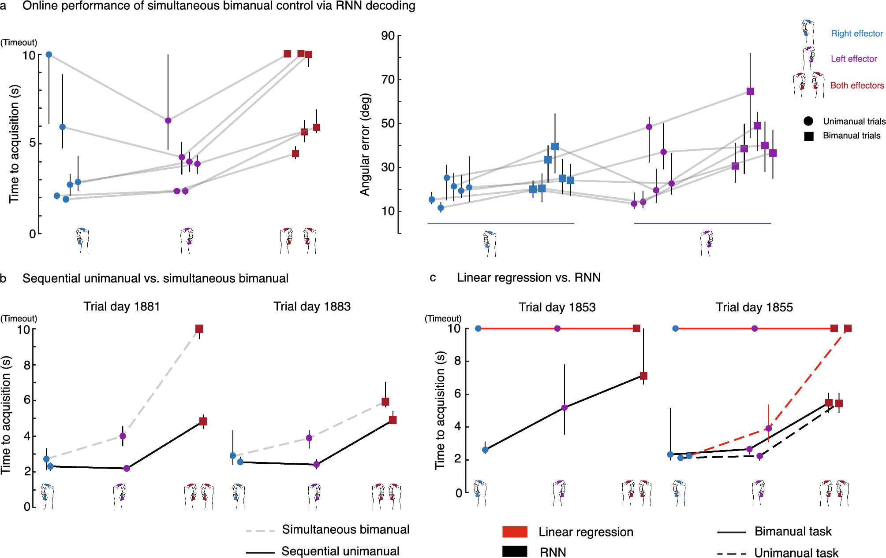</td>
<td>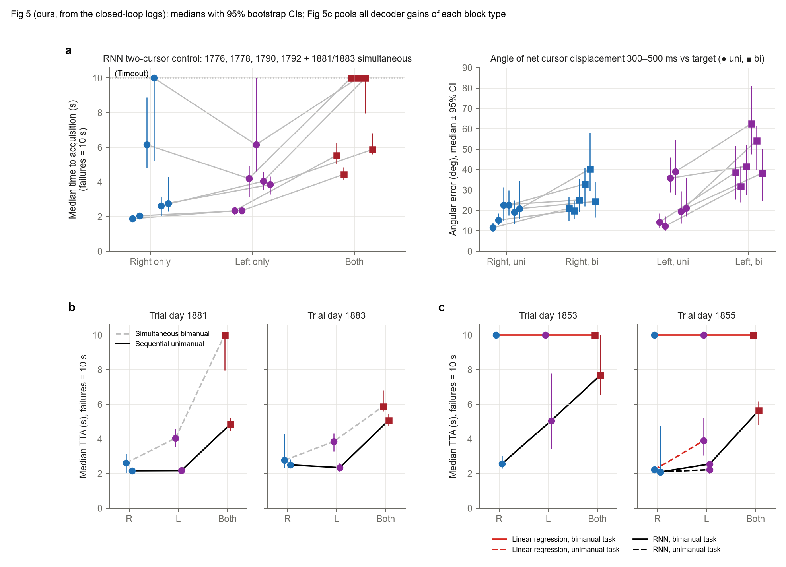</td>
</tr>
</table>

Original-format figure: [fig5_online.png](../results/figures/fig5_online.png).

**Fig 5a, median TTA (s)** with failures counted as 10 s. Sessions are matched to the paper's points by value:

| Session | Paper ≈, uniR / uniL / bi | Ours |
|---|---|---|
| 1776 | 1.9 / 2.3 / 5.7 | 1.88 / 2.34 / 5.54 |
| 1778 | 2.1 / 2.3 / 4.4 | 2.05 / 2.34 / 4.44 |
| 1790 | 5.9 / 4.2 / 10 | 6.15 / 4.20 / 10 |
| 1792 | 10 / 6.3 / 10 | 10 / 6.15 / 10 |
| 1881, simultaneous | 2.7 / 4.0 / 10 | 2.62 / 4.04 / 10 |
| 1883, simultaneous | 2.9 / 3.9 / 5.9 | 2.77 / 3.85 / 5.87 |

**Fig 5a, angular error**, median over trials of the angle of the net displacement over 300–500 ms:

| Condition | Paper, range over sessions | Ours |
|---|---|---|
| uniR | ≈ 11–25° | 11–23° |
| biR | ≈ 20–40° | 20–40° |
| uniL | ≈ 13–49° | 12–39° |
| biL | ≈ 30–65° | 32–63° |

Our original per-bin definition gives 26–50° / 36–63° / 30–65° / 54–77° (row 3 of the table above).

**Fig 5b, median TTA (s)**, uniR / uniL / bi:

| Day | Strategy | Paper ≈ | Ours |
|---|---|---|---|
| 1881 | Sequential | 2.3 / 2.2 / 4.8 | 2.16 / 2.17 / 4.86 |
| 1881 | Simultaneous | 2.7 / 4.0 / 10 | 2.62 / 4.04 / 10 |
| 1883 | Sequential | 2.5 / 2.4 / 4.9 | 2.50 / 2.34 / 5.08 |
| 1883 | Simultaneous | 2.9 / 3.9 / 5.9 | 2.77 / 3.85 / 5.87 |

**Fig 5c, median TTA (s)**, pooled over each block type's decoder gains:

| Day | Decoder | Task | Paper ≈, uniR / uniL / bi | Ours |
|---|---|---|---|---|
| 1853 | Linear | Bimanual | 10 / 10 / 10 | 10 / 10 / 10 |
| 1853 | RNN | Bimanual | 2.6 / 5.2 / 7.1 | 2.58 / 5.06 / 7.68 |
| 1855 | Linear | Bimanual | 10 / 10 / 10 | 10 / 10 / 10 |
| 1855 | Linear | Unimanual | 2.2 / 3.9 / 10 | 2.22 / 3.90 / — |
| 1855 | RNN | Bimanual | 2.3 / 2.6 / 5.6 | 2.09 / 2.55 / 5.64 |
| 1855 | RNN | Unimanual | 2.1 / 2.2 / 5.5 | 2.10 / 2.22 / — |

**Notes.**
- **NEW:** with the paper's statistic and session set, Fig 5 reproduces almost point for point (rows 1–3 of the table above).
- "—": the unimanual-only blocks contain almost no bimanual trials in the logs, so we have no value.

## Supp Fig 1: single-electrode tuning

<table>
<tr><th width="50%">Paper</th><th width="50%">Ours, paper layout (day 1750)</th></tr>
<tr>
<td></td>
<td>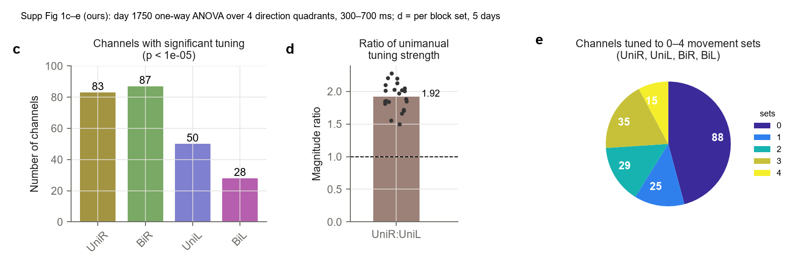</td>
</tr>
</table>

Original-format figure: [supp_fig1_tuning_counts.png](../results/figures/supp_fig1_tuning_counts.png).

| Quantity | Paper | Ours (p < 1e-5, 4 quadrants, 300–700 ms) | Closest variant (D1: p < 1e-3, 8 directions) |
|---|---|---|---|
| (c) Tuned, UniR / BiR / UniL / BiL | 90 / 97 / 60 / 52 | 83 / 87 / 50 / 28 | 90 / 100 / 62 / 40 |
| (e) Tuned to 0 / 1 / 2 / 3 / 4 contexts | 82 / 16 / 33 / 27 / 34 | 88 / 25 / 29 / 35 / 15 | 82 / 18 / 28 / 38 / 26 |
| (d) UniR:UniL tuning ratio | 1.95 | **1.92** (mean of 22 block sets) | — |

**Differences** (rows 4–5 of the table above):
- **d:** explained by aggregation.
- **c/e:** sensitive to the threshold and grouping. The table of all 16 variants is in `diagnostics.json`, key D1.

## Supp Fig 2: speed distributions and bimanual decoding

<table>
<tr><th width="50%">Paper</th><th width="50%">Ours, paper layout (day 1883)</th></tr>
<tr>
<td>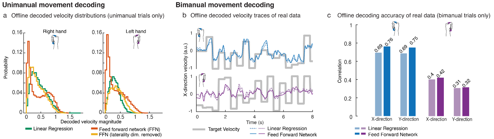</td>
<td>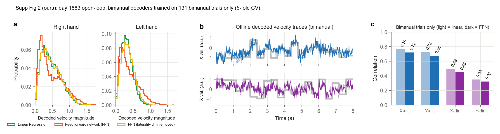</td>
</tr>
</table>

| Bimanual-trial r (R x / R y / L x / L y) | Paper | Ours |
|---|---|---|
| Linear | 0.69 / 0.69 / 0.40 / 0.31 | 0.76 / 0.73 / 0.49 / 0.35 |
| FFN | 0.76 / 0.75 / 0.42 / 0.32 | 0.72 / 0.68 / 0.45 / 0.32 |

**Notes.**
- **Speed distributions (a):** the paper's FFN histogram has a tall spike near zero speed (the idle cursor held still); ours peaks at about 0.15–0.25. This is the same FFN difference as the jitter in Fig 3c (row 8 of the table above).
- **Bimanual decoding (c):** right hand ≫ left hand, as the paper. Our FFN is slightly below ridge, where the paper's is slightly above (row 8).

## Supp Fig 4: fSNR

<table>
<tr><th width="50%">Paper</th><th width="50%">Ours, paper layout (day 1883)</th></tr>
<tr>
<td></td>
<td>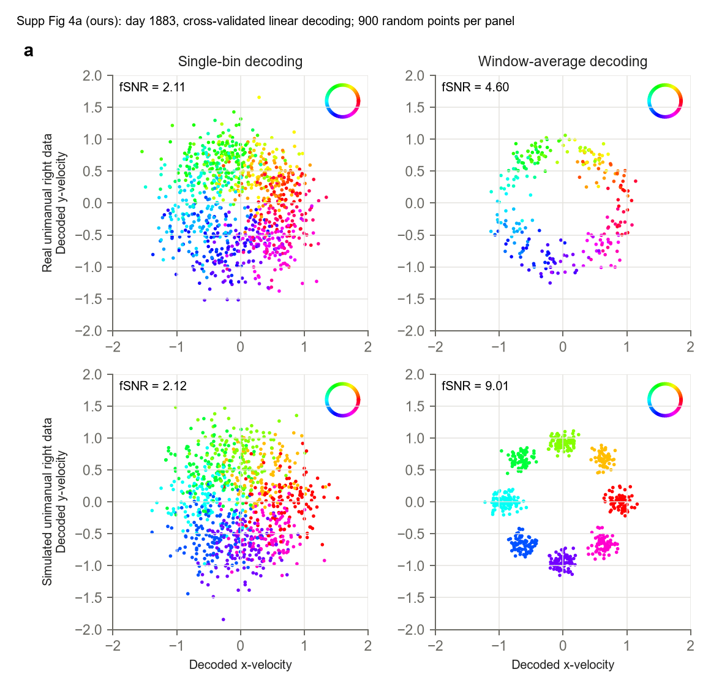</td>
</tr>
</table>

Original-format figure: [supp_fig4_fsnr.png](../results/figures/supp_fig4_fsnr.png).

| fSNR | Paper | Ours |
|---|---|---|
| Real, single bin / 400-ms window | 2.03 / 4.10 | 2.11 / 4.60 |
| Simulated i.i.d. noise, single bin / window | 2.03 / 8.61 | 2.12 / 9.01 |

**Notes.**
- The conclusion reproduces: noise matched on single bins overstates the window-average fSNR about 2×.
- Our simulated window-average points form 8 clusters because we simulated 8 target directions (row 12 of the table above).

---

## Reproduce
```
pixi run paper-style                     # our results in the paper's layouts (about 2 min)
pixi run python scripts/diagnose_differences.py   # the D1-D4 checks (about 5 min, GPU for D3)
pixi run figure-comparison               # copy into docs/figure_comparison/ (add --paper-dir DIR to re-crop the paper)
pixi run docs-html                       # rebuild docs/html/
```
