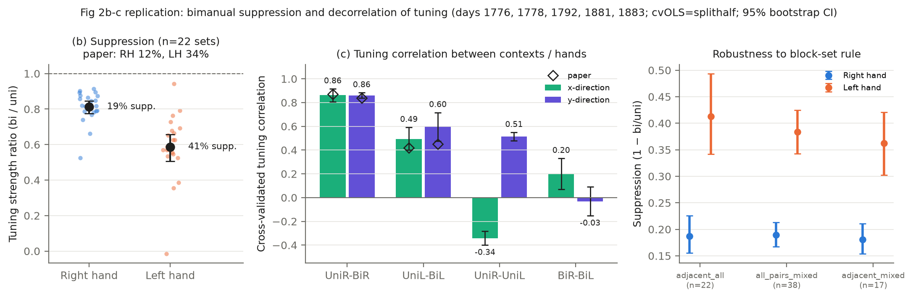
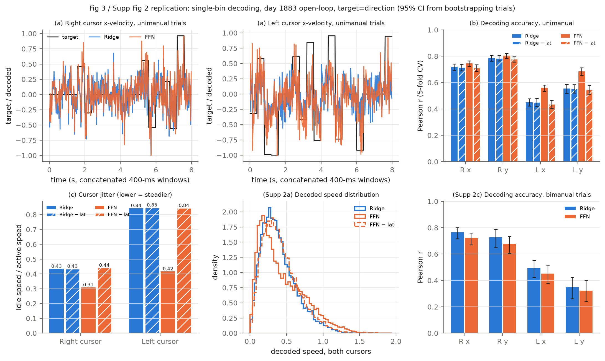
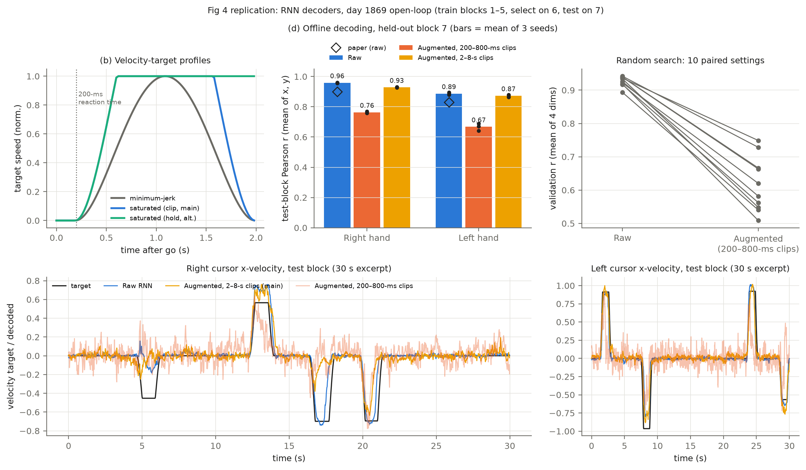
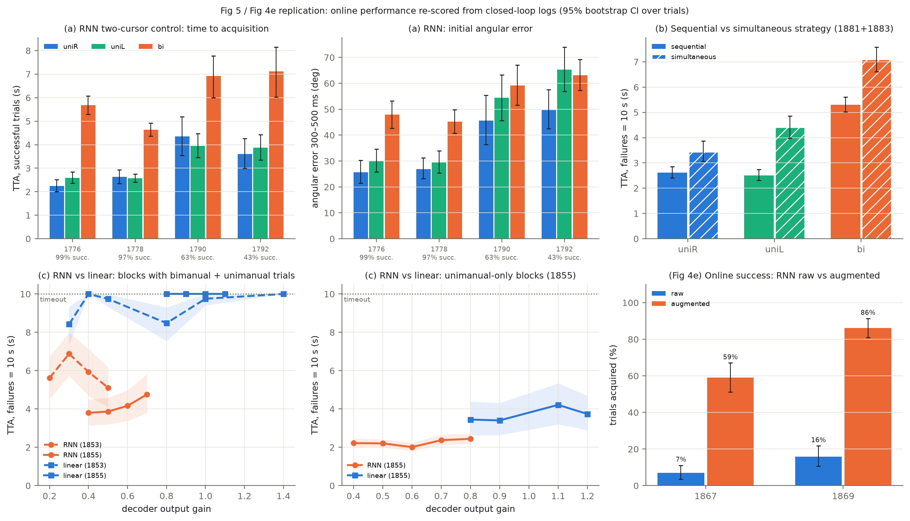
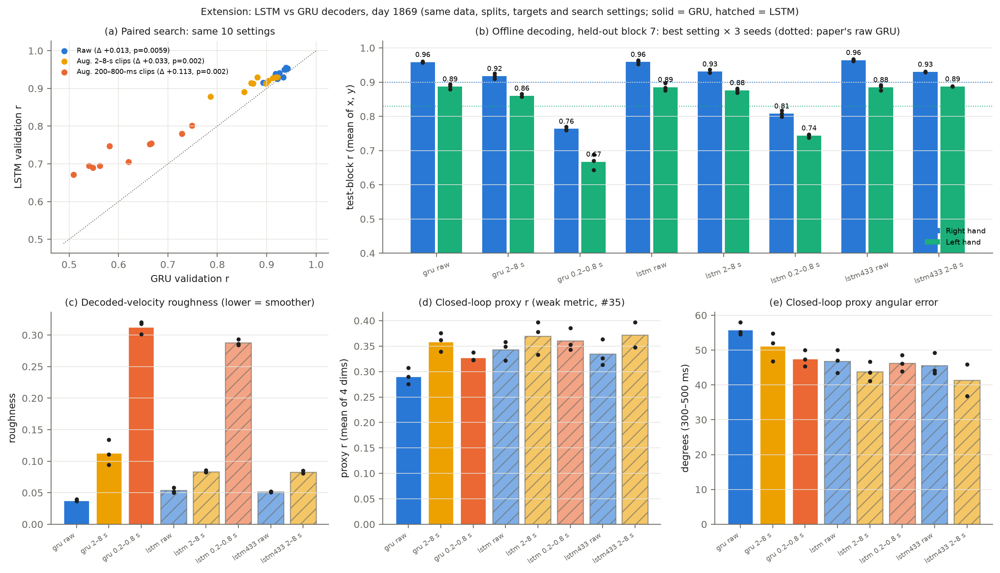
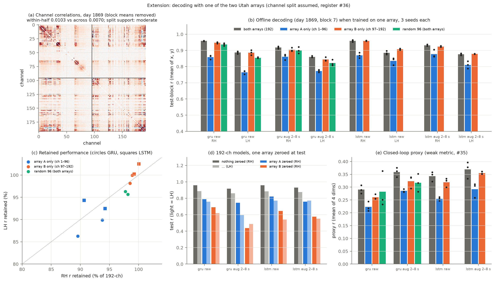
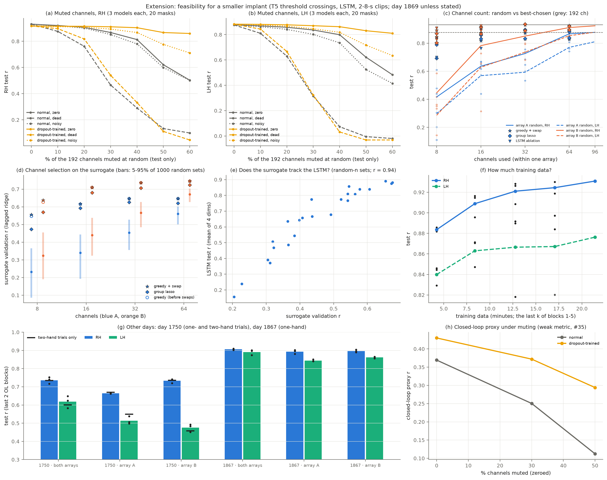
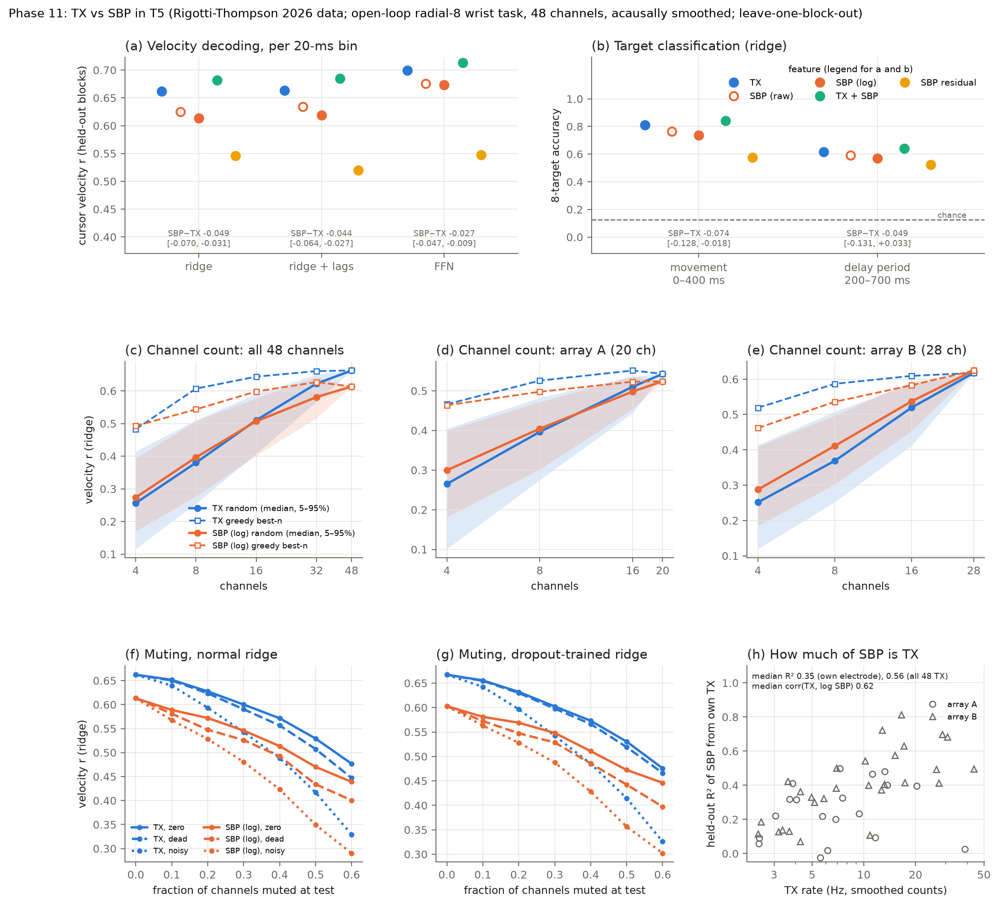

# Write-up: replicating Deo et al. 2024 from the Dryad data

*Personal notes, 2026-11-21. The full record is in [REPLICATION.md](../REPLICATION.md): a results table with CIs and the numbered register of decisions (#1–31 for the replication, #32–46 for the extensions). The per-phase notes are in [briefings.md](briefings.md).*

**Paper:** Deo et al., "Brain control of bimanual movement enabled by recurrent neural networks", *Sci Rep* 14:1598 (2024).

**Data:** 13 sessions of participant T5: 192 electrodes on two 96-electrode Utah arrays in left motor cortex, threshold crossings in 20-ms bins.

## TL;DR
- **Every qualitative claim replicates** from the public data with an independent Python pipeline. Most headline numbers land within a few points of the paper's.
- **The core neural finding is solid.** During bimanual movement, the left (non-dominant) hand's tuning is suppressed about 2× more than the right hand's, and it decorrelates. "Which hand" (laterality) explains more variance than direction.
- **The decoder logic holds up.**
  - A nonlinear decoder beats a linear one *because* it uses the laterality signal; removing that signal erases the gain.
  - Simulations reproduce the mechanism.
  - RNNs decode well offline. Training on time-warped, shuffled clips costs a little offline but is what made online control work.
- **Bimanual time to target** is about 2× unimanual in the logs, where the paper's text says "only slightly longer" (#30). The paper's own Fig 5a shows the same 2× ([figure comparison](figure_comparison.md)), so only the wording disagrees.
- **Redrawn in the paper's own figure formats** ([figure comparison](figure_comparison.md)), most panels match closely. With the paper's statistic (median, failures = 10 s) and session set, all 18 Fig 5a time-to-target points match, and the angular errors match with the paper's definition (#8).
- **Remaining gaps:**
  - suppression somewhat larger in ours (RH 19% vs 12%), partly an estimator choice;
  - fewer tuned electrodes in Supp Fig 1 at our threshold;
  - our FFN is jitterier at rest than the paper's and leans more on laterality. The cause is not the data or its training settings (open).
- **Two of the paper's methods had to change to work at all:**
  - 5-fold cross-validated regression → split-half (#23)
  - raw position-difference regressors → unit direction (#21)

  The paper also contradicts itself on the augmentation clip length (#14); only the 2–8-s reading reproduces it.

## Claim by claim

### Figs 1–2: how the neural code changes from one hand to two
| Claim | Paper | Ours |
|---|---|---|
| Example electrodes 97 / 13 / 23 behave as described | qualitative | ✅ same patterns |
| Tuning suppression (bimanual vs unimanual), RH / LH | 12% / 34% | 18.7% / 41.3% |
| Unimanual-vs-bimanual tuning correlation, RH (x/y) | 0.87 / 0.84 | 0.86 / 0.86 |
| Same, left hand (LH, x/y) | 0.42 / 0.45 | 0.49 / 0.60 |
| Supp Table 1 significance pattern | 11 of 12 significant | same pattern in 11/12 |
| Bimanual activity sits closest to unimanual RH (PCA) | yes | yes; distance 0.28 vs 3.21 in PC1–2 |
| dPCA: laterality vs direction share of variance | 39% / 30% | 39% / 29% (0–1000 ms) |

The LH effect is strong (t-test p = 6e-6, n = 22). It holds under all three block-pairing schemes: RH 18–19%, LH 36–41%.

The dPCA result only comes out right **with cross-validation**; plain variance estimates flip the order. The 0–1000 ms window matches the paper best. Our pre-registered 300–700 ms window gives 41% / 33%, which points the same way.

### Fig 3: why the decoder must be nonlinear
| Claim | Paper | Ours (day 1883) |
|---|---|---|
| FFN beats ridge, mostly on the LH | qualitative | +0.07 r overall, +0.12 LH (p < 0.001) |
| Removing laterality hurts the FFN only | qualitative | FFN −0.08 (LH −0.13); ridge ±0.000 |
| FFN keeps the idle cursor steadier | qualitative | LH jitter 0.42 vs ridge 0.84; back to 0.84 without laterality |
| Single-bin fSNR (unimanual RH) | 2.03 | 2.11 |
| Simulation: ridge degrades with RH–LH correlation; FFN survives if laterality is large | qualitative | ✅ ridge 0.59 → 0.50; FFN flat at about 0.69 |

Every effect also holds with the alternative regression target, recorded cursor velocity (#11), though all r values are lower that way.

### Fig 4: RNNs and temporal fracturing (day 1869)
| Claim | Paper | Ours |
|---|---|---|
| Raw-trained RNN offline r, RH / LH | 0.90 / 0.83 | 0.96 / 0.89 (3 seeds, spread < 0.01) |
| Augmented RNN: slightly worse and noisier offline | qualitative | 2–8-s clips: 0.93 / 0.87, roughness 2× (0.08 vs 0.04) |
| Augmented RNN works online, raw fails | qualitative | success 59% / 86% vs 7% / 16% (days 1867 / 1869, from the logs) |

The offline number says little about online success. Raw and augmented models are within 0.03 r offline, yet more than 50 points apart in online success. This is the paper's point, and it is the reason the extensions add a closed-loop proxy metric.

### Fig 5: online control (re-scored from logged trials)
- ✅ Bimanual angular error is higher: 52° vs 34° / 43°, on every day.
- ✅ A sequential strategy beats a simultaneous one: bimanual 5.3 vs 7.1 s.
- ✅ The RNN beats the linear decoder; the linear decoder mostly times out on mixed blocks.
- ⚠️ Bimanual time to acquisition is 5.4 s vs 2.8 / 3.0 s unimanual: about 2×, not "slightly longer".

## Where we differ, and why
| # | Issue | What we did | Effect |
|---|---|---|---|
| 14 | The paper gives the clip length as both "0.2–0.8 × snippet" (2–8 s) and "200–800 ms" | Ran both. MAIN = 2–8 s | Only 2–8 s gives "slightly poorer"; 200–800 ms drops r by about 0.2 |
| 21 | Eq. 2 regresses on raw target − cursor (distances 30–750 units) | Unit direction instead | Ratios and correlations don't depend on scale; the distance confound is removed |
| 23 | 5-fold cross-validated regression on about 25 bimanual trials per set | Split-half (50 random halves) | 5-fold gave a correlation of 1.20 and 62% suppression (unstable); split-half is unbiased and stable in simulation |
| 30 | Bimanual time to target "only slightly longer" | Logged `durationBinnedMove` | About 2× on every day. The paper may define it differently (dwell excluded? first target?). **Check the Fig 5a bars.** |
| 29 | Fig 5a lists days 1752 / 1771 | Not used | Those files have no closed-loop blocks |

Smaller assumptions (target definitions, quadrants, analysis windows, FFN details) are in the register. Most were later confirmed against the full text on PMC.

## How much to trust each result
- **Robust:**
  - LH > RH suppression and decorrelation (every block-pairing scheme)
  - laterality > direction (every day, with cross-validation)
  - FFN > ridge and the laterality dependence (both regression targets)
  - raw RNN offline r (across seeds and settings)
  - every online effect (every day)
- **Sensitive to choices:**
  - RH suppression size (12 vs 19%)
  - the dPCA percentages (analysis window)
  - augmented-RNN offline r (clip length)
  - Supp Fig 1 tuned-electrode counts (quadrant definition, #6)
- **Not testable offline:** whether the 2–8-s-clip RNN would also work online. The logged online sessions used the authors' decoder, whose clip length we don't know.

## Pitfalls hit along the way
- **k-fold cross-validated regression blows up when folds hold about 5 trials for 5 parameters.** Split-half fixed it.
- **Recorded open-loop cursor velocity is a poor target.** The cursor starts moving about 300 ms after go, so in the 300–700 ms window it is mostly an onset ramp. The unit target direction is the right target, and the paper confirms it.
- **dPCA variance without cross-validation is biased toward the noisier marginalizations.**
- **The augmentation sampler never placed a clip near a segment edge,** so it never sampled "rest". Fixed and covered by a unit test.
- **Windows: conda-forge MKL's `libomp` clashes with PyTorch's `libiomp5md`** (OMP Error #15). Using OpenBLAS fixed it.

## Extensions

### LSTM instead of GRU (Phase 8)
Same data, splits, augmentation and the same 10 search settings, so each setting is a paired comparison.

- **Raw data:** the LSTM is better in 9 of 10 paired settings, but only by +0.013 validation r. On the test block it ties the GRU: 0.96 / 0.89.
- **With temporal fracturing** the LSTM is clearly better:
  - 2–8-s clips: +0.033 validation r in 10 of 10 settings. Test r 0.93 / 0.88 vs 0.92 / 0.86, and smoother output.
  - 200–800-ms clips: +0.11 validation r.
  - So the LSTM gives up less offline accuracy for the augmentation.
- A parameter-matched LSTM (433 units, about 1.08M recurrent parameters, the same as GRU-512) does as well as LSTM-512.
- **Closed-loop proxy** (weak, #35): even the raw LSTM scores about like the augmented GRU (r 0.34 vs 0.36, angle 47° vs 51°; raw GRU 0.29, 56°). This suggests, without proving, that an LSTM might be less fragile online.

### One array instead of two (Phase 9)
We retrained the decoders on channels 1–96 ("array A") or 97–192 ("array B"). That the split falls there is an assumption, supported by the data's correlation structure (#36).

- **Array B alone matches both arrays**: 98–103% of the 192-channel test r.
- **Array A alone keeps 86–94%.** The left hand is hit hardest, less so with an LSTM.
- **96 random channels drawn from both arrays keep 96–98%.** So which array matters, not just how many channels.
- **Without retraining, losing an array is severe.** Zeroing it at test drops r to 0.44–0.82, worst for losing B and for augmented models.

Practical reading: on this day, almost all the decodable information is on array B; a decoder must be retrained (or trained with array dropout) to survive losing an array.

### Feasibility for a smaller, SBP-only implant (Phases 10–11)
The question: could this method work on an implant with 8 flexible shanks × 32 electrodes over about one Utah array's area, in one hemisphere, recording SBP only? We can't test that implant, but we can test the parts of the question the T5 data can answer. Full numbers: REPLICATION.md, Phases 10–11.

**Channels (Phase 10).**
- **The best few channels carry most of the signal.** 8 well-chosen channels of array B keep 96–97% of the 192-channel r; 16 keep 98–100%. On the weaker array A, 8 chosen channels keep 86–92%.
- **Random small subsets are much worse and unpredictable** (8 random channels: r 0.11–0.61). With 256 electrodes the target system should have plenty of good ones, but it needs a way to find them.
- **Greedy forward selection with swaps**, on a fast linear stand-in for the decoder, picked sets as good as or better than group lasso or LSTM ablation. The stand-in ranks channel sets the same way the LSTM does (r = 0.94).

**Bad channels (Phase 10).**
- **Training with random channel dropout** makes the LSTM robust when bad channels are detected and zeroed, or merely noisy. With half the channels zeroed it keeps 94–95% of its r, vs 67–71% without dropout training, and it costs almost nothing when nothing is muted.
- **Undetected dead channels break every decoder.** A silent channel looks like a huge negative z-score. Online bad-channel detection is a must.

**Data and days (Phase 10).**
- **One 4-minute block of training data** already gives 95–96% of the r from 21 minutes, offline.
- **"One array is enough" depends on the day.** It holds on day 1867. On day 1750, a harder mixed one- and two-hand day, array B keeps the right hand but loses 23% on the left hand. Two-hand trials decode about as well as all trials.

**SBP instead of threshold crossings (Phase 11).** Public T5 data with both signals on 48 electrodes:
- **All 48 electrodes:** SBP is 4–9% behind threshold crossings.
- **4–16 electrodes:** SBP equals or beats crossings; on array B it is equal or better at every count.
- **Muting:** SBP degrades about as much as crossings.
- **The caveats are serious and mostly favour crossings.** These electrodes were selected for their crossings; the data is acausally smoothed; the task is open-loop and one-handed; and it is one session. See [ext_sbp_notes.md](ext_sbp_notes.md).

**What this means for the 8 × 32 system.** Nothing here rules it out:
- One array's area with good channels decoded both hands well offline on two of three days.
- SBP seems roughly as informative as crossings.
- Dropout training plus bad-channel detection handles lost channels.

The open questions need data from that system:
- whether its SBP carries the hand-specific (laterality) signal;
- how many of its 256 electrodes are good;
- how it behaves in closed loop.

## Pointers
- Paper figures next to ours, panel by panel: [figure_comparison.md](figure_comparison.md)
- Results table and register: [REPLICATION.md](../REPLICATION.md)
- What to check in the paper yourself: [paper_check.md](paper_check.md); the ❓ rows are Fig 5a TTA and the Supp Fig 1 counts
- Method → code map: [methods_notes.md](methods_notes.md)
- How to rerun: the README "Replication" section
